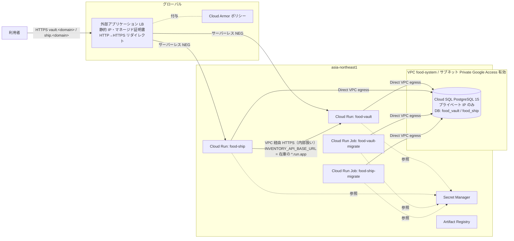

# 設計: GCP 本番基盤の Terraform 化

- 要求: [requirements.md](requirements.md)
- リージョン: `asia-northeast1`(LB・Cloud Armor・証明書はグローバル)

## 1. 全体構成



| 経路 | 制御 |
| :-- | :-- |
| 外部 → `*.run.app` 直アクセス | ingress `INGRESS_TRAFFIC_INTERNAL_LOAD_BALANCER` で拒否 |
| 外部 → LB → 在庫 `/api/*` | Cloud Armor で 403 |
| 発送 → 在庫 `/api/v1` | 発送の egress を `ALL_TRAFFIC` にして VPC を通し、内部トラフィックとして在庫サービスに届ける(Private Google Access 経由)。認証は従来どおり Bearer トークン |
| アプリ・Job → Cloud SQL | Direct VPC egress でプライベート IP に接続(パブリック IP なし) |

- 発送の egress は全トラフィック VPC 経由のため、インターネットに出られない(現状、外部呼び出しは無い)。必要になれば Cloud NAT を追加する(スコープ外)

## 2. ディレクトリ構成

```
infra/terraform/
├── README.md                  # 前提・初回構築・デプロイ手順
├── versions.tf                # terraform / provider のバージョン、backend "gcs"(部分設定)
├── backend.hcl.example        # bucket / prefix の例
├── terraform.tfvars.example   # 変数の例(実値はコミットしない)
├── variables.tf
├── outputs.tf                 # LB の IP、各 URL、Job 名
├── apis.tf                    # API 有効化
├── registry.tf                # Artifact Registry
├── network.tf                 # VPC・サブネット・プライベートサービス接続
├── sql.tf                     # Cloud SQL インスタンス
├── secrets.tf                 # 両アプリ共通の秘密(在庫 API トークン)
├── tests/plan.tftest.hcl     # terraform test(モックプロバイダ)
├── apps.tf                    # module "food_vault" / module "food_ship" の呼び出し
├── lb.tf                      # IP・証明書・NEG・バックエンド・URL マップ・プロキシ・転送ルール
├── armor.tf                   # Cloud Armor ポリシー
└── modules/app/               # 1 アプリ分(DB・ユーザー・秘密・SA・Cloud Run サービス・Job)
    ├── main.tf
    ├── variables.tf
    └── outputs.tf
```

- 2 アプリは同じ形のため `modules/app` にまとめ、差分(環境変数・秘密・egress)は引数で渡す
- `.gitignore` に `.terraform/`・`*.tfstate*`・`terraform.tfvars`・`backend.hcl` を追加する(`.terraform.lock.hcl` はコミットする)

## 3. 主な変数

| 変数 | 既定 | 内容 |
| :-- | :-- | :-- |
| `project_id` | — | GCP プロジェクト |
| `region` | `asia-northeast1` | |
| `domain` | — | 独自ドメイン。ホスト名は `vault.<domain>` / `ship.<domain>` |
| `food_vault_image_tag` / `food_ship_image_tag` | — | イメージのタグ(イメージは `<region>-docker.pkg.dev/<project>/food-system/<app>:<tag>`) |
| `initial_admin_email` | — | 初期管理者のメール(両アプリ共通) |
| `db_tier` | `db-custom-1-3840` | Cloud SQL のマシン |
| `deletion_protection` | `true` | Cloud SQL の削除保護 |
| `min_instances` / `max_instances` | `0` / `2` | Cloud Run のスケール |
| `allowed_source_ranges` | `[]` | 空なら全許可。指定するとその CIDR 以外を Cloud Armor で拒否 |
| `rate_limit_per_minute` | `600` | IP ごとのレート上限(超過は 429) |
| `inventory_warehouse_id` | `""` | 発送の対象倉庫 ID(段階 4 で使う。初回は空) |

## 4. リソース詳細

### 4.1 ネットワーク・Cloud SQL

- VPC `food-system`(自動サブネットなし)、サブネット `food-system-run`(`10.10.0.0/24`、`private_ip_google_access = true`)
- プライベートサービス接続: `google_compute_global_address`(`VPC_PEERING`、/16)＋ `google_service_networking_connection`
- Cloud SQL: `POSTGRES_15`、`ENTERPRISE` エディション、`ipv4_enabled = false`・`private_network` 指定、自動バックアップ＋PITR、`deletion_protection` は変数
- DB 接続は暗号化なし(プライベート IP・VPC 内)。`runtime.exs` の `ssl` はコメントのまま変えない

### 4.2 秘密情報(Secret Manager)

| 秘密 | 生成 | 利用 |
| :-- | :-- | :-- |
| `food-vault-database-url` / `food-ship-database-url` | `random_password`(DB ユーザー)から `ecto://<user>:<pass>@<private_ip>/<db>` を組み立て | `DATABASE_URL` |
| `food-vault-secret-key-base` / `food-ship-secret-key-base` | `random_password`(64 文字) | `SECRET_KEY_BASE` |
| `food-vault-initial-admin-password` / `food-ship-initial-admin-password` | `random_password` | Job の `INITIAL_ADMIN_PASSWORD` |
| `inventory-api-token` | `random_password`(英数 64 文字) | 在庫 `INVENTORY_API_TOKENS`・発送 `INVENTORY_API_TOKEN` |

- 生成値は state に残るため、state バケットへのアクセスを絞る(README に記す)。初期管理者パスワードは `gcloud secrets versions access` で確認する

### 4.3 サービスアカウント(アプリごと)

- `food-vault-run@` / `food-ship-run@`: サービスと Job で共用。付与するのは自アプリの秘密への `secretmanager.secretAccessor` と `cloudsql.client`(プライベート IP 接続では必須ではないが付与しておく)のみ
- 発送 → 在庫は ingress で内部に限っており、Cloud Run の IAM 認証は使わない(`invoker_iam_disabled = true`。外部からの到達は ingress で遮断済み。`allUsers` への付与は組織ポリシーで拒否されることがあるため使わない)

### 4.4 Cloud Run サービス(`modules/app`)

| 項目 | 値 |
| :-- | :-- |
| ingress | `INGRESS_TRAFFIC_INTERNAL_LOAD_BALANCER` |
| egress | 在庫: `PRIVATE_RANGES_ONLY` / 発送: `ALL_TRAFFIC`(Direct VPC egress、サブネット `food-system-run`) |
| ポート・タイムアウト | `4000`、リクエストタイムアウト 3600 秒(LiveView の WebSocket) |
| 実行環境 | 第 2 世代(`runtime.exs` が IPv6 の `::` で待ち受けるため、Linux 互換の実行環境にする。Job も同じ) |
| リソース | 1 vCPU / 1 GiB、スケールは変数 |
| 環境変数 | `PHX_SERVER=true`・`PHX_HOST=<app>.<domain>`・`POOL_SIZE=5`・`DATABASE_URL`・`SECRET_KEY_BASE`(秘密参照) |
| 在庫のみ | `INVENTORY_API_TOKENS`(秘密参照) |
| 発送のみ | `INVENTORY_API_BASE_URL=<在庫サービスの uri>`・`INVENTORY_API_TOKEN`(秘密参照)・`INVENTORY_WAREHOUSE_ID` |
| ヘルスチェック | startup probe は TCP 4000 |

- `force_ssl`(`rewrite_on: [:x_forwarded_proto]`)は LB が付ける `X-Forwarded-Proto: https` で満たされる。発送 → 在庫も `https://*.run.app` なので問題ない
- WebSocket の `check_origin` は `PHX_HOST` から決まる(LB のホスト名と一致)

### 4.5 Cloud Run Job(`modules/app`)

- イメージ・SA・VPC・`DATABASE_URL`・`SECRET_KEY_BASE` はサービスと同じ。加えて `INITIAL_ADMIN_EMAIL`・`INITIAL_ADMIN_PASSWORD`
- 在庫の Job は `runtime.exs` が `INVENTORY_API_TOKENS` 未設定で落ちるため、これも渡す
- コマンド: `/app/bin/<app> eval "<App>.Release.migrate_and_seed()"`、`max_retries = 0`、タイムアウト 600 秒
- Terraform は Job を作るだけで実行しない(実行は `gcloud run jobs execute --wait`)

### 4.6 ロードバランサ(`lb.tf`)

- `google_compute_global_address`、`google_compute_managed_ssl_certificate`(`vault.<domain>`・`ship.<domain>`)
- アプリごとに `google_compute_region_network_endpoint_group`(`SERVERLESS`)＋ `google_compute_backend_service`(`EXTERNAL_MANAGED`、`security_policy` 付与、ログ有効)
- URL マップ: ホストルールで振り分け。既定(どのホストにも一致しない。IP 直打ちなど)は在庫のホストへ 301 リダイレクト(URL マップは既定の転送先が必須のため)
- HTTPS プロキシ＋転送ルール(443)、HTTP は別 URL マップで HTTPS へ 301 リダイレクト(80)
- 証明書の発行には DNS の A レコード(出力の IP)登録が必要(利用者が設定)

### 4.7 Cloud Armor(`armor.tf`、両バックエンド共通の 1 ポリシー)

| 優先度 | 条件 | 動作 |
| :-- | :-- | :-- |
| 100 | `request.path.lower().matches('^/+(a\|%61)(p\|%70)(i\|%69)(/\|$)')` | deny(403)。在庫 API を外部から遮断(発送には `/api` が無いので共通で問題ない)。Plug は空のパス要素を無視し、要素を URL デコードするため `//api`・`%61pi` も対象にする |
| 1000 | `sqli-v33-stable`(感度 1) | deny(403) |
| 1001 | `xss-v33-stable`(感度 1) | deny(403) |
| 1002〜 | `lfi` / `rfi` / `rce` / `scannerdetection` / `protocolattack` の `v33-stable`(感度 1) | deny(403) |
| 2000 | `allowed_source_ranges`(未指定なら `*`) | throttle(IP 単位、`rate_limit_per_minute`/分、超過 429。上限内は allow) |
| 2147483647 | 既定 | `allowed_source_ranges` 指定時は deny(403)、未指定なら allow |

- throttle は上限内なら allow で評価を終えるため、送信元の制限は「throttle の対象を許可 CIDR に絞り、既定を deny にする」形で実現する(1 ルールの CIDR は 10 件まで。変数で検証)

- 誤検知(LiveView の送信内容など)が出たら、ルールの `opt_out_rule_ids` で個別に外す。初回は `preview` にしない

## 5. アプリ側の変更

### 5.1 生成(`mix phx.gen.release --docker`)

- 両アプリで実行する(Docker Compose 経由: `docker compose run --rm food_vault_web mix phx.gen.release --docker`)
- 生成物: `Dockerfile`・`.dockerignore`・`rel/overlays/bin/server`・`rel/overlays/bin/migrate`・`lib/<app>/release.ex`(既存のため上書き確認が出る。**上書きせず**、生成される `migrate/0`・`rollback/2` を既存ファイルへ手で取り込む)
- `Dockerfile` のベースイメージは生成時の Elixir / OTP に合わせて出力される(結果: `hexpm/elixir:1.20.5-erlang-29.1.2-debian-trixie-20261104-slim`、実行は `debian:trixie-20261104-slim`・ユーザー `nobody`。修正不要)
- アセットは `mix assets.deploy`(tailwind / esbuild のみ。npm 依存は無い)で生成 Dockerfile のまま動く

### 5.2 `{App}.Release`(両アプリ)

```elixir
@app :food_vault

def migrate do
  load_app()
  for repo <- repos() do
    {:ok, _, _} = Ecto.Migrator.with_repo(repo, &Ecto.Migrator.run(&1, :up, all: true))
  end
end

def rollback(repo, version) do ... end   # 生成のまま

@doc "Cloud Run Job 用。マイグレーションのあと priv/repo/seeds.exs を実行する(冪等)。"
def migrate_and_seed do
  migrate()
  seeds = Application.app_dir(@app, "priv/repo/seeds.exs")
  {:ok, _, _} = Ecto.Migrator.with_repo(FoodVault.Repo, fn _repo -> Code.eval_file(seeds) end)
  :ok
end
```

- 既存の `create_initial_admin/0`・`run/0` はそのまま残す(`seeds.exs` が `run/0` を呼ぶ)
- `seeds.exs` は初期管理者の作成が `:error`(環境変数未設定)でも次に進み、在庫側は管理者が見つからず `Repo.one!` で落ちる。Job では環境変数を必ず渡すため、そのままにする
- `seeds.exs` はリリースの `priv/` に含まれる(追加設定は不要)

## 6. デプロイ手順(README に記す)

1. state 用 GCS バケットを作る → `terraform init -backend-config=backend.hcl`
2. 初回のみ: `terraform apply -target=google_project_service.this -target=google_artifact_registry_repository.this`
3. イメージをビルド・プッシュ: `gcloud builds submit food_vault --tag <image>`(発送も同様)
4. `terraform apply`(イメージのタグを `terraform.tfvars` で指定)
5. Job を実行: `gcloud run jobs execute food-vault-migrate --region asia-northeast1 --wait`(発送も同様)
6. 出力の IP を DNS の A レコードに登録 → 証明書が `ACTIVE` になるまで待つ
7. 更新時: 新しいタグでビルド → tfvars のタグ変更 → `terraform apply` → Job 実行(Job とサービスが同時に新イメージになるため、互換性のないマイグレーションは避ける。architecture §5 の「NOT NULL 追加は default 付き」に従う)

## 7. 検証

- `terraform fmt -check`・`terraform validate`・`terraform test`(`tests/plan.tftest.hcl`。プロバイダをモックして plan を評価)
- 両アプリで `mix compile --warnings-as-errors`・`mix format`・`mix credo`・`mix test`(Release の変更のため)
- 可能なら本番イメージの `docker build` が通ること
- 実 GCP への `apply` はこのセッションでは行わない(利用者が実施)

## 8. ドキュメント反映

- `architecture.md`: §2.1 に本番構成(本図の要約)、§11 に Secret Manager での供給、§16 #3 を「解決済み(GCP)」に
- `repository-structure.md`: `infra/terraform/`・各アプリの `Dockerfile`・`rel/` を追加
