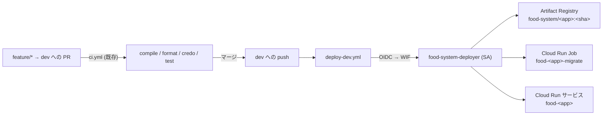

# 設計: GitHub Actions による dev 環境への自動デプロイ

- 要求: [requirements.md](./requirements.md)
- リージョン: `asia-northeast1`(Terraform の `var.region`)
- 関連: [20261105-gcp-terraform/design.md](../20261105-gcp-terraform/design.md)(GCP 基盤)

## 1. 全体構成



| 経路・制御 | 内容 |
| :-- | :-- |
| 品質ゲート | PR 時の `ci.yml`(変更なし)。`dev` への push 後は再実行せず、デプロイのみ行う |
| 認証 | GitHub OIDC トークン → Workload Identity Federation → デプロイ用 SA を借用 |
| 認可の絞り込み | プロバイダの `attribute_condition` でリポジトリと ref(`refs/heads/dev`)を限定 |
| デプロイ順 | アプリは vault → ship。各アプリは Job 更新 → Job 実行(待機) → サービス更新 |
| 直列化 | `concurrency: deploy-dev`(`cancel-in-progress: false`) |

## 2. ディレクトリ構成(変更点のみ)

```
.github/workflows/
└── deploy-dev.yml          # 新規
infra/terraform/
├── ci.tf                   # 新規: WIF プール/プロバイダ・デプロイ用 SA・IAM
├── apis.tf                 # iamcredentials / sts を追加
├── variables.tf            # github_repository / github_deploy_branch を追加
├── outputs.tf              # GitHub Variables に登録する値を追加
├── modules/app/
│   ├── main.tf             # service / job の image 等を ignore_changes
│   └── outputs.tf          # service_account_name を追加
├── tests/plan.tftest.hcl   # WIF 条件・ロールの assert を追加
└── README.md               # 更新手順を書き換え
```

## 3. 主な変数・設定値

### Terraform 変数(追加)

| 変数 | 既定 | 用途 |
| :-- | :-- | :-- |
| `github_repository` | `suzuki-t0505/food_system` | WIF を許可するリポジトリ(`owner/repo`)。空でないことを validation |
| `github_deploy_branch` | `dev` | WIF を許可するブランチ。`refs/heads/<branch>` に組み立てる |

### GitHub Environment `dev` の Variables(秘密ではない値のみ。Secrets は使わない)

| 名前 | 値の取得元(`terraform output`) |
| :-- | :-- |
| `GCP_PROJECT_ID` | `var.project_id` |
| `GCP_REGION` | `var.region` |
| `GCP_WORKLOAD_IDENTITY_PROVIDER` | `workload_identity_provider` |
| `GCP_SERVICE_ACCOUNT` | `deployer_service_account` |

## 4. リソース詳細

### 4.1 Workload Identity Federation(`ci.tf`)

- `google_iam_workload_identity_pool.github`: `workload_identity_pool_id = "github"`
- `google_iam_workload_identity_pool_provider.github`
  - `oidc { issuer_uri = "https://token.actions.githubusercontent.com" }`
  - `attribute_mapping`: `google.subject = assertion.sub`、`attribute.repository = assertion.repository`、`attribute.ref = assertion.ref`
  - `attribute_condition`: `assertion.repository == "<github_repository>" && assertion.ref == "refs/heads/<github_deploy_branch>"`
    - 条件を満たさない OIDC トークン(他リポジトリ、`dev` 以外のブランチからの `workflow_dispatch` など)はトークン交換の時点で拒否される
    - このため `workflow_dispatch` は実質 `dev` 上でのみ成功する(要求のスコープ外「現在のブランチをビルド」に一致)
- プール削除は 30 日のソフト削除になる(`destroy` 後の再作成で同じ ID が使えない場合は ID を変える)。README に注記する

### 4.2 デプロイ用サービスアカウント(`ci.tf`)

- `google_service_account.deployer`: `account_id = "food-system-deployer"`。キーは作らない
- `google_service_account_iam_member.deployer_wif`: `roles/iam.workloadIdentityUser`、member は `principalSet://iam.googleapis.com/<pool.name>/attribute.repository/<github_repository>`
- 付与ロール(最小権限)

| ロール | 付与先 | 理由 |
| :-- | :-- | :-- |
| `roles/artifactregistry.writer` | `food-system` リポジトリのみ(`google_artifact_registry_repository_iam_member`) | イメージの push |
| `roles/run.developer` | プロジェクト(`google_project_iam_member`) | サービス/Job の更新、Job の実行と実行結果の参照 |
| `roles/iam.serviceAccountUser` | `food-vault-run`・`food-ship-run` の 2 SA のみ(`google_service_account_iam_member`) | Cloud Run の更新時に実行 SA を `actAs` するため |

  - `run.developer` はプロジェクト単位だが、Cloud Run のリソースはこの基盤の 4 つ(サービス 2・Job 2)に限られる。リソース単位(`google_cloud_run_v2_service_iam_member` 等)に絞る案もあるが、サービス/Job の再作成で IAM が外れる運用負担が大きいため今回は見送る
  - 実行 SA の `actAs` 対象は `modules/app` の新 output `service_account_name`(SA のリソース名)で受け取る

### 4.3 `ignore_changes`(`modules/app/main.tf`)

CI が `gcloud` でイメージを更新するため、Terraform はイメージ(と `gcloud` が書き込むクライアント情報)の差分を無視する。

```hcl
# google_cloud_run_v2_service.this
lifecycle {
  ignore_changes = [
    template[0].containers[0].image,
    client,
    client_version,
  ]
}

# google_cloud_run_v2_job.migrate
lifecycle {
  ignore_changes = [
    template[0].template[0].containers[0].image,
    client,
    client_version,
  ]
}
```

- `var.image` は **新規作成時のみ**効く(初回構築・サービス再作成時)。既存リソースの更新では参照されない
- `client` / `client_version` は `gcloud` 経由の更新で値が入り、`terraform plan` に差分として出るため併せて無視する
- 上記以外(環境変数・リソース制限・VPC など)は引き続き Terraform が管理する。Terraform の変更で新リビジョンが作られても、イメージは直前に CI がデプロイしたものが維持される

### 4.4 API の有効化(`apis.tf`)

`iamcredentials.googleapis.com`(SA の借用)と `sts.googleapis.com`(トークン交換)を `local.services` に追加する。`iam.googleapis.com` は既存。

### 4.5 output(`outputs.tf`)

- `workload_identity_provider`: `google_iam_workload_identity_pool_provider.github.name`(`projects/<番号>/locations/global/workloadIdentityPools/github/providers/github`)
- `deployer_service_account`: `google_service_account.deployer.email`

## 5. ワークフロー(`.github/workflows/deploy-dev.yml`)

### 5.1 共通

```yaml
name: Deploy (dev)

on:
  push:
    branches: [dev]
  workflow_dispatch:

permissions:
  contents: read
  id-token: write

concurrency:
  group: deploy-dev
  cancel-in-progress: false
```

- 両ジョブとも `environment: dev`(Variables を参照するため。将来 `main` / 本番を足すときは Environment と Variables を分ける)
- 変数は `vars.GCP_*` から読む。イメージの宛先は `<region>-docker.pkg.dev/<project>/food-system`(Terraform の `local.registry` と同じ形)
- アクションは `actions/checkout@v4`・`google-github-actions/auth@v2`・`google-github-actions/setup-gcloud@v2`・`docker/setup-buildx-action@v3`・`docker/build-push-action@v6`(メジャー固定。`ci.yml` の方針に合わせる)

### 5.2 `build-push`(matrix: `food_vault` / `food_ship`、並列)

1. `actions/checkout@v4`
2. `google-github-actions/auth@v2`(`workload_identity_provider` と `service_account` を指定)
3. `google-github-actions/setup-gcloud@v2` → `gcloud auth configure-docker <region>-docker.pkg.dev --quiet`
4. `docker/setup-buildx-action@v3`
5. `docker/build-push-action@v6`
   - `context: ./${{ matrix.app }}`(Dockerfile は各アプリ配下で、ビルドコンテキストもアプリのディレクトリ)
   - `tags: <registry>/${{ matrix.app }}:${{ github.sha }}`、`push: true`
   - `cache-from` / `cache-to: type=gha,scope=${{ matrix.app }}`(`mode=max`)
6. `fail-fast: false`(片方の失敗が他方のビルドを止めない。ただし `deploy` は両方成功が前提)

### 5.3 `deploy`(`needs: build-push`、単一ジョブ内で直列)

認証(2・3 と同じ)のあと、`food_vault` → `food_ship` の順に次を実行する。`gcloud` に渡すアプリ名は `food_vault` → `food-vault` のようにハイフンへ変換する。

```bash
for app in food_vault food_ship; do
  name="${app//_/-}"
  image="${REGISTRY}/${app}:${GITHUB_SHA}"

  gcloud run jobs update "${name}-migrate" --image "${image}" --region "${REGION}"
  gcloud run jobs execute "${name}-migrate" --region "${REGION}" --wait
  gcloud run services update "${name}" --image "${image}" --region "${REGION}"
done
```

- シェルは `bash -euo pipefail`(GitHub Actions の `run` の既定)。Job の実行に失敗すると終了コードが非 0 になり、当該アプリのサービス更新と、それ以降のアプリ(ship)の処理は行われない
- vault の Job が失敗した場合、ship も更新しない(ship は vault API に依存するため)
- 最後に `$GITHUB_STEP_SUMMARY` へデプロイしたアプリ・タグ(SHA)・サービス URL(`gcloud run services describe --format='value(status.url)'`)を出力する
- `gcloud run services update --image` は新リビジョンを作り、トラフィックは既定で 100% 新リビジョンへ切り替わる。ヘルス(startup probe)に失敗した場合は旧リビジョンが残るためコマンドが失敗として終わる

## 6. 初回セットアップ手順(README に記す)

1. `terraform apply`(WIF・デプロイ用 SA・API の有効化・`ignore_changes` の反映。**既存環境ではイメージの差分が出ないこと**を `plan` で確認)
2. `terraform output` の値を GitHub の Environment `dev` の Variables に登録(`gh variable set --env dev` でも可)
3. GitHub 上で `main` から `dev` ブランチを作成し、必要ならブランチ保護(PR 必須・CI 必須)を設定
4. `dev` への PR をマージ → Actions の `Deploy (dev)` が成功することを確認

更新時は、`feature/*` → `dev` への PR をマージするだけ(手動の `terraform.tfvars` タグ変更・`apply` は不要)。

## 7. 検証

- Terraform: `terraform fmt -check -recursive`、`terraform init -backend=false`、`terraform validate`、`terraform test`
  - `tests/plan.tftest.hcl` に追加する assert
    - プロバイダの `attribute_condition` にリポジトリと `refs/heads/dev` が含まれる
    - `github_repository` が空のときは `expect_failures`(validation)
    - デプロイ用 SA に Artifact Registry 書き込み・`run.developer` が付き、`serviceAccountUser` が 2 SA だけに付く
- ワークフロー: `actionlint`(利用可能なら)または YAML 構文チェック
- Docker: `docker build ./food_vault`、`docker build ./food_ship` がローカルで通る(Dockerfile は変更しないため確認のみ。環境にない場合はその旨を報告)
- 実機(作業者): 6 の手順で `dev` へマージ後、
  - Actions が成功し、`gcloud run services describe food-vault --region asia-northeast1` のイメージが当該 SHA
  - `gcloud run jobs executions list --job food-vault-migrate` に成功の実行がある
  - その後 `terraform plan` でイメージの差分が出ない

## 8. ドキュメント反映

- `infra/terraform/README.md`: 「更新(デプロイ)」を自動デプロイ手順に書き換え、WIF の初回セットアップ(§6)、`apply` してもイメージが戻らないこと、プールのソフト削除の注記を追記
- `docs/architecture.md`: §2.3(デプロイの流れ)・§14(CI に `deploy-dev` を追記)・§16 #3(CI/CD を解決済みに)
- `docs/development-guidelines.md` §3.1: `dev` ブランチと「`dev` へのマージ = dev 環境へ自動デプロイ」の運用を追記
- `docs/repository-structure.md`: `.github/workflows/deploy-dev.yml`・`infra/terraform/ci.tf` を追記
