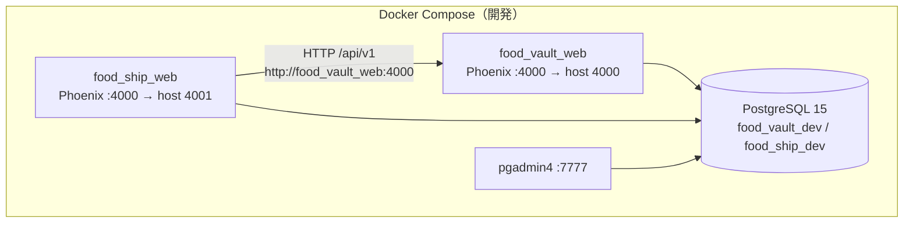
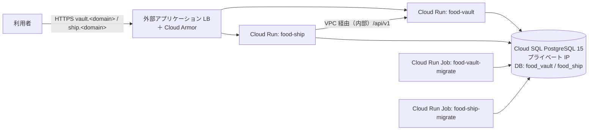
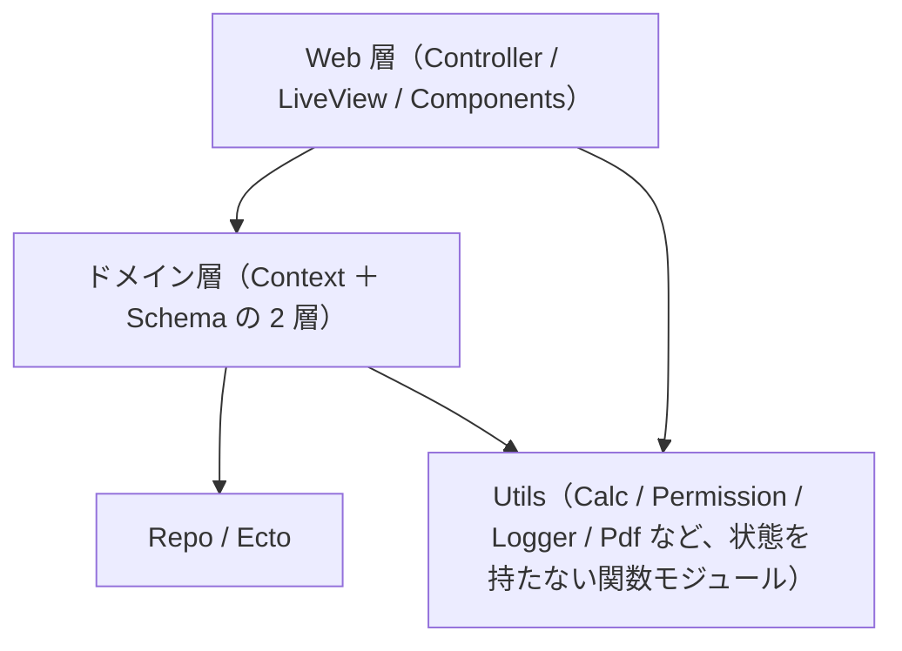

# 技術仕様書 (Architecture)

- 対象: 食品在庫管理システム（`food_vault`）と発送システム（`food_ship`）
- 位置づけ: [functional-design.md](functional-design.md) の機能を「どの技術で・どう実装するか」を定める。ディレクトリ構造の詳細は `repository-structure.md`、開発手順・レビュー観点は `development-guidelines.md`、コード規約は [coding-rules.md](coding-rules.md) に従う
- 用語は [glossary.md](glossary.md) に従う。本書の決定は、実装着手時に検証が必要なものを [§16](#16-未決事項実装着手時の検証事項) に分けて記す

---

## 1. 技術スタック

| 区分 | 採用 | 備考 |
| :-- | :-- | :-- |
| 言語 | Elixir 1.20.5 / Erlang 29（OTP 29） | `mix.exs` は `elixir: "~> 1.20"`、`Dockerfile.dev` は `elixir:1.20.5-otp-29` |
| Web | Phoenix 1.8.16 / Phoenix LiveView 1.2 / Bandit | HTTP サーバーは Bandit。JSON API は Controller、画面は LiveView |
| DB | PostgreSQL 15（`postgres:15.2`） | アプリごとに別 DB（`food_vault_dev` / `food_ship_dev`）。拡張は `citext` |
| ORM | Ecto 3.13 / ecto_sql / Postgrex | `Repo.transact/1`（Ecto 3.13+）を使う |
| ID | ULID（`Ecto.ULID`） | 依存と採否は [§4](#4-ulid-基盤) |
| HTTP クライアント | Req 0.5 | 発送 → 在庫の API 呼び出し。両アプリの `mix.exs` に導入済み |
| CSS / JS | Tailwind CSS 4（daisyUI 5）/ esbuild | `core_components.ex` は改変しない |
| PDF（発送のみ） | ChromicPDF（ヘッドレス Chromium）を推奨 | 環境構築は別セッション。前提は [§10](#10-pdf-帳票発送システム) |
| 開発環境 | Docker Compose（`food_vault_web` / `food_ship_web` / `db` / `pgadmin4`） | ホストで直接 `mix` を叩かない |
| 認証 | `mix phx.gen.auth` ベース（bcrypt） | 自己登録・マジックリンク・メール確認は除去（[§8](#8-認証認可の実装)） |

---

## 2. システム構成

### 2.1 実行構成



- 2 アプリは **別プロジェクト・別 DB・別コンテナ**。Erlang クラスタ・DB 共有はしない（各 `--sname` / `--cookie` も別）。
- 発送 → 在庫の **一方向 HTTP のみ**。在庫システムから発送システムへの呼び出しは無い。
- 開発時のホストポート: 在庫 4000、発送 4001（コンテナ内はどちらも 4000）。
- 本番（GCP）の構成は [§2.3](#23-gcp-構成)。

### 2.3 GCP 構成

`infra/terraform/` で定義する（手順は `infra/terraform/README.md`、設計は `.steering/20261105-gcp-terraform/design.md`）。リージョンは `asia-northeast1`。現時点の GCP 環境は開発環境用で、シードに開発用マスタを含める。



| 項目 | 決定 |
| :-- | :-- |
| TLS 終端 | 外部アプリケーション LB（Google マネージド証明書）。HTTP は HTTPS へ 301。`force_ssl` は LB の `X-Forwarded-Proto` で満たす |
| Cloud Run | アプリごとに 1 サービス。ingress は `internal-and-cloud-load-balancing`（`*.run.app` へ外部から直接届かない） |
| 在庫 `/api` の送信元制限 | Cloud Armor で LB 経由の `/api` を 403。発送は egress を全トラフィック VPC 経由にし、在庫の `*.run.app` を内部トラフィックとして呼ぶ（`INVENTORY_API_BASE_URL`）。認証は従来どおりサービストークン |
| Cloud Armor | `/api` 遮断、OWASP 事前構成ルール（感度 1）、IP ごとのレート制限、送信元 CIDR の許可リスト（任意） |
| DB | Cloud SQL 1 インスタンスに DB・ユーザーをアプリごとに作る。プライベート IP のみ（Direct VPC egress で接続） |
| マイグレーション・シード | アプリごとの Cloud Run Job が `{App}.Release.migrate_and_seed/0`（マイグレーション → `priv/repo/seeds.exs`。冪等）を実行する。デプロイは「イメージ更新 → `terraform apply` → Job 実行」 |
| イメージ | `mix phx.gen.release --docker` で生成した各アプリの `Dockerfile`。Artifact Registry `food-system` に置く |


### 2.2 実行時の依存

| 依存元 → 先 | 方式 | 認証 |
| :-- | :-- | :-- |
| 発送 → 在庫 | HTTPS（開発は HTTP）JSON API `/api/v1` | `Authorization: Bearer <サービストークン>` |
| 各アプリ → DB | Postgrex（接続プール `POOL_SIZE`、既定 10） | 環境変数 `PGHOST` / `PGPASSWORD`、本番は `DATABASE_URL` |
| 発送 → Chromium | ChromicPDF のセッションプール | ローカルプロセス |

---

## 3. アプリケーション構成とレイヤ

### 3.1 レイヤ



| 層 | 決定 |
| :-- | :-- |
| ドメイン層 | **Context ＋ スキーマの 2 層だけ**。サービス層・リポジトリ層・ユースケース層は作らない。子エンティティ専用の Context は作らない。ディレクトリ ＝ 集約単位（coding-rules §2.1） |
| Web 層 | Context の公開 API だけを呼ぶ。LiveView / Controller / Component から `Repo` やスキーマへのクエリを直接書かない（§2.2） |
| Utils | `lib/{app}/utils/`。状態を持たない関数モジュール（GenServer にしない） |
| 外部 I/O 境界 | 発送の `FoodShip.Inventory.Client`（HTTP）と `FoodShip.Utils.Pdf`（Chromium）。DB を持たず、テストでモックしてよい唯一の境界 |

### 3.2 Context とスキーマ

**在庫管理システム（`FoodVault`）**

| Context | スキーマ（集約） |
| :-- | :-- |
| `FoodVault.Accounts` | `User`, `UserToken` |
| `FoodVault.Makers` | `Maker` |
| `FoodVault.Warehouses` | `Warehouse` |
| `FoodVault.Items` | `Item` |
| `FoodVault.Inventories` | `InventoryLot`, `InventoryTransaction`（入荷・移動・調整、ロットのロックと更新） |
| `FoodVault.ShipmentOrders` | `ShipmentOrder`, `ShipmentOrderLine`, `ShipmentAllocation`, `ShipmentOrderEvent`（引当・確定・解除・出庫取消）。補助モジュール `Request`（要求の検証・正規化・冪等判定の比較）と `AllocationPlan`（明細 1 行の引当計画。純粋関数）。**段階 2 で実装済み**（出庫取消は P1） |

**発送システム（`FoodShip`）**

| Context | スキーマ（集約） |
| :-- | :-- |
| `FoodShip.Accounts` | `User`, `UserToken` |
| `FoodShip.Clients` | `Client` |
| `FoodShip.ShippingItems` | `ShippingItem` |
| `FoodShip.ExpirationRules` | `ExpirationRule` |
| `FoodShip.ShippingSlips` | `ShippingSlip`, `SlipAllocatedLot`（登録・引当・再引当・数量変更・梱包・取消・箱数の修正。**段階 4 で実装済み**。一括再引当・CSV 取込は段階 5）。補助モジュール `AllocationResult`（在庫 API の応答 → 伝票への反映内容。純粋関数） |
| `FoodShip.TotalPicks` | `TotalPick`（作成・再発行・取消・ピック明細と仕分け内訳の集計。段階 5） |
| `FoodShip.Inventory.Client` | 在庫側 API クライアント（`Req`）。外部境界モジュール |

- Context が肥大したら集約単位で分割する（目安 800 行、または 1 ファイルに集約が 3 つ以上）。
- 状態遷移は業務動詞で命名する。在庫: `allocate_shipment_order/1` / `ship_shipment_order/1` / `cancel_shipment_order/1` / `reverse_shipment_order/2`。発送: `create_shipping_slip/2` / `allocate_shipping_slip/2` / `update_shipping_slip/3` / `pack_shipping_slip/2` / `cancel_shipping_slip/2` / `update_box_count/3`（段階 4 で実装済み）、`reallocate_shipping_slips/2` / `reverse_shipping_slip/3` / `create_total_picks/2` / `reissue_total_pick/2` / `cancel_total_pick/2`（段階 5）。
- **書き込み関数は操作者を第 1 引数に取る**。画面は `user`、在庫 API は `{:api, operator}` を渡し、それぞれ `user_id` / `operator` に記録する。

### 3.3 Context 間の責務（在庫側）

引当・確定・解除・出庫取消は `ShipmentOrders` が担うが、**ロットのロックと数量の更新ロジックは `Inventories` に 1 か所だけ持つ**。`Inventories` は、`Ecto.Multi` を受け取って積む公開関数（例：商品行の `FOR SHARE`、ロットの一括ロック、ロットの加減算、受払履歴の記録）を提供し、`ShipmentOrders` は同一 Multi でそれらを呼ぶ。これにより、ロックキー順・CHECK 制約に合う更新・受払履歴の記録が分散せず、同一トランザクションも保たれる。

### 3.4 Web 層

- LiveView のファイル構成・命名は `index.ex` / `show.ex` / `form.ex`（coding-rules §2.4 / §9）。ロール別に UI が分かれる場合はサブディレクトリで分ける。
- JSON API（在庫）は LiveView 対象外。`FoodVaultWeb.Api.V1.*` の Controller と `:api` pipeline で実装する（[§7](#7-在庫-api-の実装)）。
- PDF 帳票（発送）は LiveView ではなく `FoodShipWeb.ReportController`（[§10](#10-pdf-帳票発送システム)）。
- 表示用の整形（総バラ数など）は Web 層に書かず、`FoodVault.Utils.Calc` に集約する。Enum 値と表示ラベルの対応は 1 か所に置く（coding-rules §16.3）。
- 文言は単一言語のため gettext を使わず直書きし、文体を統一する（coding-rules §16.4）。リソース名は用語集に揃える。

---

## 4. ULID 基盤

実装の最初（スキーマを作る前）に次を済ませる。

| 項目 | 決定 |
| :-- | :-- |
| 依存 | **`ecto_ulid_next`**（`Ecto.ULID` を提供する Hex パッケージ。`~> 1.0`）を採用した。Elixir 1.20 / Ecto 3.13 で警告なくコンパイルでき、`{App}.Schema` のテスト（保存・取得・FK・形式検証）が通ることを確認済み |
| 共通スキーママクロ | `{App}.Schema`（`@primary_key {:id, Ecto.ULID, autogenerate: true}`・`@foreign_key_type Ecto.ULID`）を最初に作り、全スキーマが `use {App}.Schema` する。`use Ecto.Schema` の直書きは禁止（coding-rules §5.1） |
| DB 列 | マイグレーションは `add :id, :binary_id, primary_key: true` ／ FK は `references(:table, on_delete: :nothing, type: :binary_id)`。PostgreSQL の `uuid` 型（16 バイト）で保存される |
| `config.exs` | `generators` の `binary_id: true` は残す（マイグレーション生成を `:binary_id` にするため）。ただし `phx.gen.*` が出すスキーマは UUID の `:binary_id` なので、生成後に `use {App}.Schema` へ手で置き換える |
| `phx.gen.auth` | 生成された `User` / `UserToken` のスキーマ・マイグレーション・テストのフィクスチャも ULID 化する |
| ID の形式検証 | Context の `get_*` は `<<_::208>>`（26 文字）ガードで受ける（coding-rules §4.2）。API は、パスの ID が不正なら 404、ボディの ID が不正なら 422 にし、500 にしない |
| 並び順 | ULID の `id` 昇順は同一ミリ秒内の生成順を保証しない。先出しの第 3 優先は「順序を一意にするタイブレーク」としてのみ使い、作成順の意味は持たせない |

---

## 5. データベース

| 項目 | 決定 |
| :-- | :-- |
| 拡張 | `citext`（`users.email`）。最初のマイグレーションで `CREATE EXTENSION IF NOT EXISTS citext`（`execute/2` の up/down 2 引数形式） |
| マイグレーション | `{timestamp}_{動詞_対象}.exs`、`def change` を使う。データ移行は `execute(up, down)` の 2 引数形式（coding-rules §14）。**インデックスは `create table` ブロックの外**に書く。NOT NULL 追加は `default:` を付ける（デプロイ中は旧コードが動くため） |
| 主キー・FK | `id` は ULID（`binary_id` 列）。FK は `on_delete: :nothing`、必須 FK に `null: false` |
| 列挙 | `Ecto.Enum`（DB 列は `:string`）。ENUM 型は使わない |
| 日時 | `timestamps(type: :utc_datetime)`。業務日付は `date` 型。JST への変換は表示直前のみ（`Utils.ConvertDatetime`） |
| 論理削除 | `archived_at`。物理削除しない |
| 制約 | 不変条件は changeset と **DB の CHECK 制約の両方**で守る。一意制約は changeset の `unique_constraint` と `unsafe_validate_unique` を対で書き、対応する `unique_index`（部分ユニーク含む）を必ず DB に作る（coding-rules §5.7） |
| 索引 | FK と検索条件に作る（一覧は functional-design §3） |
| 採番（発送） | `slip_no` / `pick_no` は DB シーケンス。スキーマでは `read_after_writes: true` の読み取り専用フィールドとし、`cast` しない |
| 接続 | プールサイズ `POOL_SIZE`（既定 10）。同時に長時間のトランザクションを張る処理（CSV の引当は Task で 1 件ずつ）を避ける |

---

## 6. トランザクションと並行制御（在庫側）

### 6.1 トランザクション

- 在庫の更新（入荷・引当・荷崩し・確定・解除・出庫取消・移動・調整）は、**1 つの `Ecto.Multi` を `Repo.transact/1` で実行する単一トランザクション**。途中で失敗したら全体をロールバックする。
- 可変個の明細・ロットは `Enum.reduce` で Multi を積み、ステップ名は **文字列**（`"lot_#{id}"`）で生成する（atom を動的生成しない、coding-rules §7.3）。
- 引当アルゴリズムは「ロックしたロット一覧から、純粋関数で引当計画（どのロットから何ケース・何バラ・荷崩しは何ケース）を計算 → 計画を Multi で適用」の 2 段に分けると、読みやすくテストしやすい。不足は明細ごとに集計し、最後に 1 つでもあればロールバック（`{:error, :insufficient_stock, shortages}`）する。
- `cast_assoc` / `put_assoc` は使わない。

### 6.2 ロック

| 項目 | 実装 |
| :-- | :-- |
| 商品行 | 入荷・引当・移動先作成は `items` 行を `lock: "FOR SHARE"` で読む（`item_id` 昇順）。マスタ更新は `lock: "FOR UPDATE"`（入数・期限区分の変更ガードの競合対策） |
| ロット | `from l in InventoryLot, where: ..., order_by: [asc: l.warehouse_id, asc: l.item_id, asc: l.expiration_date, asc: l.received_date, asc: l.id], lock: "FOR UPDATE"` を **1 クエリで**発行する。操作の途中で追加のロットをロックしない |
| 順序 | 全操作共通のロックキーは `(warehouse_id, item_id, expiration_date, received_date, id)`。先に `items` の `FOR SHARE`、次にロットの `FOR UPDATE`（`items` → ロットの順を全操作で固定する） |
| 引当 | 明細を `item_id` 昇順に並べ替え、その商品群のロットを 1 クエリでロックしてから計画を立てる。ロックするのは「指定倉庫・商品、`expiration_date >= 出庫予定日`、有効在庫あり」のロット。明細ごとの最低許容期限日は、ロック後に明細ごとに絞り込んで適用する（明細ごとに条件が違っても 1 クエリでロックするため）。ロックの順序は 倉庫（`FOR SHARE`）→ 商品（`FOR SHARE`、`id` 昇順）→ ロット |
| 確定・解除・出庫取消 | 引当明細の `lot_id` を `IN` で 1 クエリロック |
| 移動 | 移動先ロットを `INSERT ... ON CONFLICT DO NOTHING`（数量 0）で先に確保し、移動元・移動先の 2 ロットを 1 クエリでロック |
| 入荷 | `Repo.insert(..., on_conflict: [inc: [case_qty: n, piece_qty: m]], conflict_target: [:warehouse_id, :item_id, :expiration_date, :received_date], returning: true)` で原子的に加算 |
| 隔離レベル | PostgreSQL 既定の `READ COMMITTED`。二重引当は `FOR UPDATE` と CHECK 制約（`0 <= allocated <= qty`）の二重で防ぐ |

### 6.3 冪等性の実装（API ①）

1. トランザクションの前に、`external_slip_id`（`cancelled` 以外）の既存オーダーを検索し、要求内容の**正規化（`warehouse_id`・`shipment_date`・明細を `item_id` 順に並べた `item_id`/`req_cases`/`req_pieces`/`min_expiration_date`）**を比較する。一致なら既存を 200 で返し、不一致は 409 `idempotency_conflict`。
2. 新規作成で `unique_constraint`（部分ユニーク索引名を `name:` に指定）違反になった側は、500 にせず、**既存オーダーを再取得して 1 と同じ比較**を行う。
3. 冪等応答ではオーダー履歴・受払履歴を追加しない。②③④ はすでにその状態なら現状を返し、それ以外の状態は 409 `invalid_state`。

---

## 7. 在庫 API の実装

### 7.1 ルーティングと pipeline

```elixir
# lib/food_vault_web/router.ex（イメージ）
pipeline :api do
  plug :accepts, ["json"]
  plug FoodVaultWeb.Plugs.ServiceTokenAuth
end

scope "/api/v1", FoodVaultWeb.Api.V1 do
  pipe_through :api
  resources "/shipment_orders", ShipmentOrderController, only: [:create, :show, :index]  # index は ?external_slip_id=
  post "/shipment_orders/:id/ship", ShipmentOrderController, :ship
  post "/shipment_orders/:id/cancel", ShipmentOrderController, :cancel
  post "/shipment_orders/:id/reverse", ShipmentOrderController, :reverse
  get "/warehouses", WarehouseController, :index
  get "/items", ItemController, :index
end
```

- `ShipmentOrderController` の `index` は `?external_slip_id=` の照会専用（パラメータなしは 422）。
- ブラウザ用の `:browser` pipeline（CSRF・セッション）は通さない。

### 7.2 サービストークン認証

- `FoodVaultWeb.Plugs.ServiceTokenAuth`（モジュール plug）。`Authorization: Bearer <token>` を読み、設定のトークン一覧のいずれかと **`Plug.Crypto.secure_compare/2`**（定数時間）で比較する。一致しなければ 401 `unauthorized` で `halt`。
- トークン一覧は環境変数 `INVENTORY_API_TOKENS`（カンマ区切り・複数可）。**ローテーション**は「新トークンを追加（旧と併存）→ 発送側の設定を切り替え → 旧を削除」。
- 設定は `config :food_vault, FoodVaultWeb.Plugs.ServiceTokenAuth, tokens: [...]`。dev は `runtime.exs` の既定値（`dev-inventory-api-token`）、test は `test.exs`、**本番は `INVENTORY_API_TOKENS` が未設定（空）なら `runtime.exs` で起動時に `raise`**。トークンは運用者が用意する固定値で、システムでは発行しない（DB 発行・有効期限は将来機能。照合は `valid_token?/1` の 1 関数に閉じ込めてある）。
- 全登録トークンと比較してから判定する（一致位置が応答時間に出ない）。失敗時は 401 に `www-authenticate: Bearer` を付け、`:api` カテゴリで `warn` する。
- トークンの値はログに出さない（`Authorization` ヘッダを出力しない）。
- 本番は TLS を終端し、`/api` を発送システムの送信元（社内ネットワーク）に限定する（リバースプロキシ）。

### 7.3 エラー形式の統一

- `FoodVaultWeb.Api.FallbackController`（`action_fallback`）で、Context の戻り値を共通形式 `{ "error": "<code>", "message": "<説明>", ...付加情報 }` に変換する。本文は `FoodVaultWeb.Api.ErrorResponse.body/3` の 1 か所で作る（認証 plug・`ErrorJSON` も使う）。
- ルーティング前に起きるエラー（存在しないルート、壊れた JSON）は Endpoint が `ErrorJSON` で描画するため、**`ErrorJSON` も共通形式**にしている（`%{errors: %{detail: ...}}` の既定形式は使わない）。`Accept` が無い・`*/*` のクライアントにも JSON を返すよう、`config.exs` の `render_errors` は **`json` を先頭**（fallback）にしている。ブラウザ（`Accept: text/html`）は HTML のまま。`Plug.Parsers` の例外は Endpoint 直下で拾われ、手前の plug で `put_format` しても反映されないため、plug ではなくこの設定で解決している。
- 対応: `{:error, :not_found}` → 404 `not_found`、`{:error, :invalid_state}` → 409 `invalid_state`、`{:error, :idempotency_conflict, order}` → 409（既存の `order_id` と `status` を含む）、`{:error, :insufficient_stock, shortages}` → 422、`{:error, %Ecto.Changeset{}}` → 422 `validation_failed`（`errors` に項目別）。
- 不正な ID 形式（パス）は 404、ボディの ID は 422。存在しないルートも同じ形式で 404 を返す。`{:error, %Ecto.Changeset{}}` の節は作っていない（`validation_failed` は `Request` が返す `[%{path, message}]` を `errors` にそのまま出す）。
- `{:error, :idempotency_conflict, order}` は Context が既存オーダー（`id`・`status`）を返し、409 の `order_id`・`status` に使う（競合の再比較で既存が見つからない稀なケースだけ `nil` で、付加情報なしの 409）。ID 取得は `ShipmentOrders.fetch_shipment_order/1`（ULID 形式でない・不存在は `{:error, :not_found}`）、照会は `list_shipment_orders_by_slip/1`（取消済みを含め新しい順）。
- `operator`（最大 255 文字・必須）と任意の `reason` は `FoodVaultWeb.Api.Operator` で検証し、成功時のみ `OperationLog` に `api_operator` として残す（冪等な再送では記録しない）。
- 共通のオーダー表現（レスポンス）は `FoodVaultWeb.Api.V1.ShipmentOrderJSON` に 1 か所で定義し、①②③④⑤ から呼ぶ。

---

## 8. 認証・認可の実装

### 8.1 `phx.gen.auth` の取り扱い

- 生成物から **自己登録・マジックリンク・メール確認・メール変更・配信（`UserNotifier`）・sudo mode を取り除き、パスワード認証のみ**にした（在庫・発送の両アプリ）。`users_tokens` は `session` コンテキストのみで、生成物の `sent_to`・`authenticated_at` は持たない。セッション有効期間は `inserted_at` ベースで、14 日（7 日経過で再発行）。「ログインしたままにする」（remember me、cookie 14 日）は `phx.gen.auth` の既定を残している。セッション cookie は署名のみで暗号化しない（中身はランダムなトークンのみで、失効は DB の行削除で行う）。
- ユーザーは管理者が登録する。パスワードは bcrypt、最小 12 文字。ログイン失敗時のエラーは 1 種類（「メールアドレスまたはパスワードが正しくありません。」）。
- パスワード再設定は管理者が行う運用（メール基盤は使わない）。再設定後は `must_change_password = true`。
- 初期管理者は seeds（開発）／リリースタスク（本番）で作成する。初期パスワードは `runtime.exs` 経由の環境変数から読み、作成後に `must_change_password = true`。実装は `{App}.Accounts.ensure_initial_admin/0`（冪等。有効な `admin` がいれば何もしない）と、それを呼ぶ `{App}.Release.create_initial_admin/0`、GCP の Cloud Run Job が呼ぶ `{App}.Release.migrate_and_seed/0`（§2.3）、`seeds.exs`（`{App}.Release.run/0`）。設定キーは `config :{app}, {App}.Accounts.InitialAdmin`（開発は `admin@example.com` / `admin-password-dev` が既定。本番は環境変数が必須で、未設定ならタスクが報告して終了する）。
- スキーマには `@derive {Inspect, only: [...]}` を付け、`password` / `current_password` は `virtual: true, redact: true`、`hashed_password` は `redact: true`（coding-rules §5.4）。

### 8.2 `current_scope`

現在ユーザーは Phoenix 1.8 の `current_scope`（`current_scope.user`）で扱い、`<Layouts.app current_scope={@current_scope} ...>` に渡す。coding-rules §11.3 の `current_user` は `current_scope.user` と読み替える。assign する場所は plug と `on_mount` の 2 箇所に限る。`current_scope` が無いというエラーが出たら、ルートを正しい `live_session` に移し、`Layouts.app` に渡す（各アプリの `AGENTS.md`）。

### 8.3 認可の 3 層

| 層 | 実装 |
| :-- | :-- |
| ① HTTP plug | `require_authenticated_user`（全ロール）／`require_authenticated_admin_user`（`admin`）。PDF 帳票の Controller は `staff` 以上に限定 |
| ② LiveView `on_mount` | `:ensure_authenticated`（全ロール）／`:ensure_authenticated_staff`（`staff` 以上）／`:ensure_authenticated_admin`（`admin`）。plug と **同じ強さのフックを `live_session` に必ず指定**する（LiveView 間遷移は plug を通らないため。coding-rules §8.3） |
| ③ イベント単位 | 同一画面に複数ロールが入る画面は `handle_event` の先頭で `Permission.can?/2` を検査し、不許可なら `put_flash(:error, "権限がありません。")`。**テンプレートの `:if` だけで隠さない**（coding-rules §11.5） |

- 判定は `{App}.Utils.Permission.can?(user, action)` に一本化する（ステートレスな関数モジュール）。権限表と 1 対 1 に対応し、ボタン表示とイベント処理の両方で同じ関数を呼ぶ。上位ロールは下位ロールの操作を含む（`admin` ⊃ `staff` ⊃ `viewer`）。
- 緊急操作（発送システム起源オーダーの画面での確定・引当解除）は、`Permission.can?/2` に専用のアクション（例 `:emergency_ship_order`）を持たせ、`admin` のみ許可する。
- ユーザー管理ルール（最後の `admin` の降格・アーカイブ禁止、自分自身のロール変更・アーカイブ禁止）は Context（`Accounts`）で強制する。
- パスワード変更・ロール変更・アーカイブ時は、そのユーザーの全 `users_tokens`（`session`）を同一トランザクションで削除する。
- ルーティング: 参照・業務画面は `/inventory_lots` 等の一般パス、`admin` 専用画面は `/management/...`、認証系は `/users/log_in` 等（coding-rules §8.4）。実装済みのルートは `/users/log_in`・`/users/log_out`・`/users/password`（パスワード変更。全ロール）・`/management/users`（`admin` 専用）。`/` も認証必須。
- `must_change_password` が true のユーザーは、plug（`require_authenticated_user`）と `on_mount`（`:ensure_authenticated*`）の両方で `/users/password` へ強制遷移する。パスワード変更画面とその送信先だけが対象外（`require_logged_in_user` plug、`:ensure_authenticated_for_password_change` `on_mount`）。
- 管理操作（`Accounts.create_user/2` など）は先頭引数に `Scope` を取り、Context でも `:manage_users` を検査する（Web 層と二重化）。「最後の `admin`」の判定は、トランザクション内で有効な `admin` を `FOR UPDATE` でロックして数える（同時実行で 0 人にならない）。

---

## 9. 発送 → 在庫の連携クライアントと非同期処理

### 9.1 `FoodShip.Inventory.Client`

- `Req` で在庫 API を呼ぶ外部境界モジュール。DB を持たない。設定は `runtime.exs` でモジュール名をキーに集約し、`System.get_env` をアプリケーションコードから直接呼ばない（coding-rules §13）。
- **リトライ**: `retry: :transient`（Req の既定 `:safe_transient` は GET / HEAD 以外を再試行しないため、POST の引当・確定・解除・出庫取消でも再試行するには明示が必要）、`max_retries: 3`、待機 1 秒・2 秒・4 秒（`retry_delay`）。対象は接続エラー・タイムアウトと 408 / 429 / 500 / 502 / 503 / 504。401 / 404 / 409 / 422 は再試行しない。
- **タイムアウト**: 接続 5 秒・受信 15 秒（設定値）。
- 状態を変える呼び出しは **`operator` を必ず付ける**。応答は、成功・在庫不足・各エラー（401/404/409/422）・通信失敗を判別できるタグ付きタプルに変換して Context に返す。
- 応答の引当バラ数の合計が `total_piece_qty` と一致するかの検証は、`Client` ではなく `ShippingSlips`（Context）が行う（実装は純粋関数 `ShippingSlips.AllocationResult`）。
- **戻り値（段階 4 で実装済み）**: 成功は `{:ok, order}`（`allocate/1` は `{:ok, order, :created | :replayed}`、`list_orders_by_slip/1` は `{:ok, [order]}`、`find_item/1` は `{:ok, item}`）。失敗は `{:error, :unauthorized | :not_found | :invalid_state | :connection}`、`{:error, :idempotency_conflict, %{order_id:, status:}}`、`{:error, :insufficient_stock, shortages}`、`{:error, :validation_failed, errors}`。5xx・トランスポートエラー・想定外の本文はすべて `:connection`（一時エラー）。オーダーは `status` を atom（固定の対応表）、日付を `Date` に変換した map。
- 設定は `FoodShip.Inventory.Client` をキーに `runtime.exs` へ集約し、実行時に読む（`base_url`・`token`・`warehouse_id`・`connect_timeout`・`receive_timeout`・`retry_base_ms`。テストは `req_options` で `Req.Test` のスタブを渡す）。`warehouse_id/0` が対象倉庫の ID（未設定は `nil`）。

### 9.2 外部 I/O とトランザクション

在庫側の状態はローカル DB のトランザクションでロールバックできないため、**在庫 API の呼び出しはローカル DB のトランザクションの外**で行う（coding-rules §7.2 の `Multi.run` 方式は採らない）。手順は、先にローカル保存（`pending`）→ API 呼び出し → 結果でローカル状態を更新。失敗時は冪等なリトライ・再引当で復旧する。

### 9.3 非同期処理（`Task` ＋ `handle_info`）

- 画面からの在庫 API 呼び出し（登録時の引当・再引当・梱包完了・取消）は LiveView のイベントハンドラ内で同期的に待たず、`Task` ＋ `handle_info` で結果を受ける（coding-rules §9.9）。実行中は対象の行・ボタンを無効化して二重送信を防ぐ。
- CSV 取込: **保存（全行 `pending` の一括 INSERT）は Task の前に完了**し、Task は引当 API の呼び出しだけを担う。`Task.start`（監視なし）のため、アプリ再起動などで中断しても、`pending` の行を一括再引当で復旧できる。進捗を DB に持たない（`pending` の件数が進捗の代わり）。
- 一括梱包完了・一括再引当は 1 伝票ずつ順に処理し、進捗（完了件数／全件）と伝票ごとの成否を `handle_info` で表示する。
- 監査ログは `Task` の中で出さず、結果を受ける `handle_info` の成功節で出す（`Task` は別プロセスのため `socket` の情報が取れない）。
- **作業画面の構成（段階 4）**: 再引当・取消・梱包完了は `start_action/5`（権限検査 → `Task.start` → `busy`〔処理中の伝票 ID の `MapSet`〕に追加）で始め、結果は `{:slip_result, action, id, result}` で受ける。`busy` の伝票は行・ボタンを無効化し、二重に押されたイベントは無視する。結果を受けたら伝票とタブの残件数を読み直し、直前のメッセージを消して最新の結果だけを表示する。箱数の修正は DB だけの更新なので `Task` にしない。
- 登録・数量変更のフォームは、保存（`pending`）まで同期で行い、引当だけを `Task` にして、結果を受けた `handle_info` で作業画面（その伝票の出荷予定日のタブ）へ遷移する。

### 9.4 同じ伝票の同時操作（段階 4）

在庫 API の呼び出しはトランザクションの外で長くなりうるため、行ロックを保持しない。代わりに次の手順で、同じ伝票の同時操作の結果が混ざらないようにする。

1. API を呼ぶ前に、短いトランザクションで伝票を `FOR UPDATE` で読み、状態を検査して `allocation_attempted_at`（`utc_datetime_usec`）を現在時刻にして「確保」する。
2. 結果の反映は、`status` と `allocation_attempted_at` が確保時のままの行にだけ `update_all` で書き込む（引当ロットの入れ替えと同じ `Multi`）。0 行なら `{:error, :stale}`（別の操作が先に進んでいる）。
3. 在庫側への呼び出しは両方が行うが、在庫側が冪等（`external_slip_id`）なので整合は保たれる。片方の解除が他方の引当後に届く稀なケースは、梱包完了時の 409 の突合で検出する。

`external_slip_id` は伝票の `id`（ULID）で、再引当・数量変更でも同じ値を使う（在庫側は `cancelled` 以外の同一 ID だけを冪等判定するため、「解除 → 同じ ID で再引当」ができる）。

---

## 10. PDF 帳票（発送システム）

### 10.1 実装方式

- 配信は LiveView ではなく **Controller**（`FoodShipWeb.ReportController`：`total_pick/2`・`work_order/2`・`total_pick_bundle/2`）。認可は HTTP plug で `staff` 以上に限定する（`on_mount` は不要）。
- HTML テンプレートは `FoodShipWeb.ReportHTML`（HEEx）で作り、A4 縦・日本語フォント（Noto Sans JP）で PDF 化する。生成は **`FoodShip.Utils.Pdf` に閉じ込める**（外部 I/O の境界。テストではこのモジュールだけをモックしてよい）。
- 推奨ライブラリは `ChromicPDF`（HTML/CSS をそのままレイアウトでき、日本語・罫線表に強い）。`Dockerfile.dev` への Chromium と `fonts-noto-cjk` の追加、`mix.exs` への依存追加、アプリ起動時の supervisor 登録が必要。環境構築は別セッションで実施し、ライブラリの最終決定はその際に行う。
- 帳票は **都度生成して保存しない**。ピック表の集計は `TotalPicks` のクエリ関数（`defp *_query/2` に分割）で都度算出し、テンプレートに計算式を書かない（coding-rules §6・§10.7）。日時は JST。

### 10.2 前提（環境構築セッションでも守る）

| 項目 | 決定 |
| :-- | :-- |
| 外部リソース | 読み込まない。テンプレートに差し込む値は HEEx のエスケープに限り、画像・フォント・スクリプト・CSS の外部 URL を書かない。日本語フォントはイメージにインストールした `fonts-noto-cjk`。商品名・メーカー名（在庫側由来）・発注元名（CSV 由来）が入るため、レビューで外部 URL が無いことを確認する |
| サンドボックス | `docker-compose.yml` の開発構成は root（`target: build_as_root`）のため、**開発環境に限り** `no_sandbox: true` を使う。**本番は root 以外のユーザーで実行し、`no_sandbox` は使わない** |
| 負荷の上限 | ChromicPDF のセッションプール数と 1 回あたりのタイムアウトを設定値にし、同時に生成できる件数を制限する（超過時は待たせる／「混み合っています」を表示）。束ね PDF が大きい場合は `Task` ＋ `handle_info` で非同期化する |
| 表示確認 | 日本語・罫線・A4 縦への収まり・改ページを実機の PDF で確認する手順を、現場確認の前に用意する |

---

## 11. 設定と秘密情報

- 秘密情報（トークン・DB パスワード・初期管理者パスワード）は **コンパイル時 config（`config.exs` / `dev.exs` / `prod.exs`）に置かず `runtime.exs`** に置く。開発用のデフォルトは「環境変数 || 開発用デフォルト」で書く。
- 必須値は `System.get_env("X") || raise "..."` で **起動時に落とす**。任意値は `System.get_env("X", "default")`。
- `System.get_env` をアプリケーションコードから直接呼ばない。設定はモジュール名をキーに `runtime.exs` に集約し、利用側は **関数経由**で解決する（`Application.get_env(:app, __MODULE__)`）。モジュール属性（`@x Application.get_env(...)`）で読まない（コンパイル時に固定されるため）。

- GCP では、秘密情報（`DATABASE_URL`・`SECRET_KEY_BASE`・`INITIAL_ADMIN_PASSWORD`・在庫 API トークン）を Terraform が生成して Secret Manager に置き、Cloud Run の環境変数として参照する（§2.3）。

環境変数（名前は命名案。実装時に確定）:

| アプリ | 変数 | 内容 | 必須 |
| :-- | :-- | :-- | :-- |
| 共通 | `DATABASE_URL`（本番）/ `PGHOST`・`PGPASSWORD`（開発） | DB 接続 | 本番は必須 |
| 共通 | `SECRET_KEY_BASE` / `PHX_HOST` / `PORT` / `POOL_SIZE` | Phoenix 標準 | 本番は必須（`POOL_SIZE` は任意） |
| 共通 | `INITIAL_ADMIN_EMAIL` / `INITIAL_ADMIN_PASSWORD` | 初期管理者の作成（seeds・リリースタスク）。**確定済み**（開発は既定値あり） | 本番の初期作成時 |
| 在庫 | `INVENTORY_API_TOKENS` | サービストークン（カンマ区切り・複数可） | 必須 |
| 発送 | `INVENTORY_API_BASE_URL` | 在庫 API のベース URL（Compose 内は `http://food_vault_web:4000`。開発は既定値あり） | 本番は必須 |
| 発送 | `INVENTORY_API_TOKEN` | 在庫 API 用のサービストークン（開発は在庫側と同じ既定値あり） | 本番は必須 |
| 発送 | `INVENTORY_WAREHOUSE_ID` | 対象倉庫 ID（在庫側 `GET /api/v1/warehouses` で確認）。**任意**: GCP の初回デプロイは空で起動するため、未設定でも起動し、設定されるまで伝票登録・再引当・数量変更を拒否する（画面に警告を表示） | 任意（業務操作には必要） |
| 発送 | `INVENTORY_API_CONNECT_TIMEOUT_MS` / `INVENTORY_API_RECEIVE_TIMEOUT_MS` | タイムアウト（既定 5000 / 15000） | 任意 |
| 発送 | PDF の設定（プール数・タイムアウト） | ChromicPDF（[§10](#10-pdf-帳票発送システム)） | 任意 |

---

## 12. ログと監査

- **Logger はカテゴリ付きのラッパー経由**（`{App}.Utils.Logger`）。カテゴリは `@categories` にホワイトリスト化し、未定義カテゴリは開発環境で例外にする。本番は JSON 形式で出力し、メタデータに `request_id` / `remote_ip` / `mfa` / `file` / `line` を含める。**バッチ処理は開始と終了で必ずログを出す**。
- **操作ログ**（`OperationLog`）: Web 層から create / update / delete を呼ぶとき、「誰が・いつ・どのページで・どのデータで・何をしたか」を 1 行で残す。**書き込みが成功したときのみ**出力し、`Task` の中では出さず `handle_info` の成功節で出す。メッセージは「ます形＋句点」で、用語は用語集に揃える。
- **実装**（両アプリの `lib/{app}/utils/`）: カテゴリは `log_in` / `create` / `update` / `delete` / `batch` / `api` / `other`。未定義カテゴリは `raise_on_unknown_category: true`（dev・test）で `ArgumentError`、本番は `false`。本番の JSON 出力は自前の `{App}.Utils.Logger.JSONFormatter`（`Jason`、新規依存なし）で、`request_id` は `Plug.RequestId`、`remote_ip` は `{App}Web.Plugs.LoggerMetadata` が設定する。リバースプロキシ配下の送信元 IP（`X-Forwarded-For`）は本番構成（§16 #3）の決定後に扱う。
- **機微データのマスクは出力側で自動化**する。`redact: true` のフィールドと `@redact_keys`（`token` / `password` など）、仮想フィールド・未ロードのアソシエーション・`__meta__` を `normalize/1` で除外する。呼び出し側で `Map.drop` する運用にしない。
- ログイン成功・失敗は `:log_in` カテゴリ。サービストークンの値と `Authorization` ヘッダは出力しない。
- **業務上の証跡は DB が担う**（在庫: `inventory_transactions` と `shipment_order_events`、発送: 伝票の `*_by_user_id` / `*_at` / `reverse_reason`）。Logger は補助で、ログのローテーション後も誰がいつ何をしたかを DB から追える。

---

## 13. テスト戦略

| 項目 | 方針 |
| :-- | :-- |
| 配置・命名 | `test/` は `lib/` をミラーする。Context テストの `describe` は「関数名/アリティ」、LiveView は画面名。`test` は日本語の説明（coding-rules §15.1–15.2） |
| フィクスチャ | Context の公開 API 経由で作る（`Repo.insert` で直接作らない）。FK はデフォルトに入れない（coding-rules §15.3） |
| 非同期 | `async` は既定 false（DB 共有）。DB に触らない純関数テストだけ `async: true`。`mix test` のエイリアスで毎回 DB を再作成 |
| mock の範囲 | 外部 I/O 境界のみ。**発送の `FoodShip.Inventory.Client`**（HTTP は `Req.Test` のスタブで差し替えてよい）と **`FoodShip.Utils.Pdf`**。自作の Context は mock しない |
| 成功系と失敗系 | 対で書き、失敗時のロールバックまで検証する |
| LiveView | 画面の表示と DB の書き込みの両方を検証する（coding-rules §15.6） |

**必須のテスト観点（在庫側）**:

- 先出し順（期限日 → 入荷日 → ロット ID）と、期限切れ・最低許容期限日未満のロットの除外
- 荷崩しの算術（`k` ケース、1 ロット 1 履歴行）、荷崩しが引当解除・出庫取消で戻らないこと
- 在庫不足でのロールバック（荷崩しも元に戻る）と、不足の全明細分の返却
- **並行性**: 同じ商品に対する同時引当で引当済数が現在庫を超えないこと、複数明細（商品順が逆）・A→B と B→A の同時移動でデッドロックしないこと（複数プロセスで検証）
- 冪等性: 内容一致の再送で 200、不一致で 409、同時 POST でも 500 にならないこと、②③④ の冪等 200 で履歴が増えないこと
- マスタ規則: ロットがある商品の入数・期限区分の変更拒否と、入荷との競合、アーカイブ可否
- 認可: 各 API・画面で、ロールごとの許可・拒否（`Permission.can?/2` と `handle_event` の両方）
- `transfer_out` / `transfer_in` が必ず対で記録されること

**必須のテスト観点（発送側）**:

- 再引当の手順（既存オーダーの照会 → 解除 → 引当 → 引当合計の検証）、解除失敗後の再引当、引当合計の不一致、同じ伝票の同時操作（`stale`）
- `Task` を使う画面のテストは、`Req.Test` を共有モード（`setup {Req.Test, :set_req_test_from_context}`、`async: false`）にし、結果を `wait_until` で待って画面と DB の両方を検証する。在庫側の応答は `InventoryStub.routes/1`（メソッド・パスで振り分け。想定外の呼び出しは例外）で組み立てる
- `Inventory.Client` の応答別（成功・在庫不足・401・404・409 `invalid_state`・409 `idempotency_conflict`・422・通信失敗）と、`allocation_error` の保存
- CSV 取込: 検証エラー時の全体不取込、`client_slip_no` の重複・空欄、保存後の中断と一括再引当による復旧
- トータルピックの作成（二重ピックの防止、同時作成）、`outdated` の遷移と再発行前の PDF 拒否
- ステータスと連動する CHECK 制約、部分ユニーク（`cancelled` / `reversed` の除外）
- 認可: `admin` のみの操作（梱包後取消・マスタ編集・ユーザー管理）

---

## 14. 開発環境・品質ゲート・CI

- 開発コマンドは **コンテナ経由**（`docker compose run --rm {service} mix ...`）。`Makefile` の `setup` / `mix_compile` / `mix_format` / `mix_credo` / `mix_test` / `mix_test_cover` / `mix_clean` を使う。
- **品質ゲート**: ① `mix compile --warnings-as-errors --force`、② `mix format`、③ `mix credo --all`、④ `mix test` を 1 つの `check` にまとめ、プッシュ前に全部パスさせる。CI でも同じ `check` を回す。
- 整備済み:
  - `Makefile` の `check`（`mix_compile` → `mix_format` → `mix_credo` → `mix_test`）。ローカルの `mix_format` は整形する。
  - 両アプリの `mix.exs` に `credo`（`only: [:dev, :test]`）、リポジトリに `.credo.exs`。`precommit` エイリアスは `compile --warnings-as-errors` / `deps.unlock --unused` / `format` / `credo --all` / `test`。
  - PR ワークフロー `.github/workflows/ci.yml`。`pull_request` のみで、アプリごとに compile → `format --check-formatted` → `credo --all` → `test` を実行する（`main` への push では回さない）。実行環境は Elixir 1.20.5 / OTP 29 と `postgres:15.2`。
  - `config/test.exs` の DB ホストは `PGHOST`（既定 `db`）で上書きできる。
- `.formatter.exs` は `import_deps`（`:ecto` / `:ecto_sql` / `:phoenix`）と HEEx フォーマッタ（`Phoenix.LiveView.HTMLFormatter`）を設定し、`inputs` に `heex` を含める。
- `mix test` は毎回 DB を再作成する（`ecto.drop` / `ecto.create` / `ecto.migrate` を alias に含める）。

---

## 15. 非機能要件の実現方針

[product-requirements.md](product-requirements.md) の非機能要件と、実現手段の対応。数値目標は「設計目標（案）」で、実装後に実測して見直す。

| 要件 | 実現手段 |
| :-- | :-- |
| 引当 API の応答（95 パーセンタイル 1 秒以内） | ロットの 1 クエリロック、荷崩しの算術化（1 UPDATE）、`(warehouse_id, item_id, expiration_date, received_date)` の複合ユニーク索引を先出しの並びに流用 |
| 作業画面の 2 秒以内表示（1 日 1,000 伝票） | `(scheduled_ship_date, status)` 索引、一覧のページネーション／日付タブ単位の読み込み、引当ロット明細の事前結合 |
| CSV 1,000 行の取込 30 秒・引当完了 15 分 | 保存を一括 INSERT（引当と分離）、引当は Task で 1 件ずつ（API の冪等・リトライと整合） |
| PDF 50 伝票 30 秒 | ChromicPDF のプール数・タイムアウトの設定、必要に応じ非同期化 |
| データ不整合の防止 | 単一トランザクション、DB の CHECK 制約、ロックキー順の固定、冪等性（内容一致判定） |
| 在庫 API の一時障害の吸収 | `retry: :transient` で最大 3 回（1・2・4 秒）、`pending` での保存、`allocation_error` の区別、一括再引当 |
| 監査 | `inventory_transactions` / `shipment_order_events` / 伝票の `*_by_user_id`、`operator` の必須化 |
| セキュリティ | 認可 3 層、サービストークン（定数時間比較・複数・TLS・送信元制限）、`redact: true`、秘密情報は `runtime.exs`、PDF の外部リソース禁止 |
| 在庫 0 ロットの肥大化 | 当面は行を残す。運用開始後にアーカイブ方針を決める（[§16](#16-未決事項実装着手時の検証事項)） |

---

## 16. 未決事項（実装着手時の検証事項）

| # | 項目 | 内容 |
| :-- | :-- | :-- |
| 1 | ULID 依存の採否 | **解決済み**: `ecto_ulid_next` を採用（§4） |
| 2 | `phx.gen.auth` 生成物の削減範囲 | **解決済み**: 実生成して確認し、§8.1 のとおり削減した。セッション有効期間は `inserted_at` ベースで設計と一致。ULID 化は schema を `use {App}.Schema` に替え、migration を `:binary_id` の主キー・FK にする |
| 3 | 本番の構成 | **一部解決**: デプロイ先を GCP（LB ＋ Cloud Armor ＋ Cloud Run ＋ Cloud Run Job ＋ Cloud SQL）とし、TLS 終端と `/api` の送信元制限を §2.3 のとおり Terraform で定義した。リリースタスク（`migrate` / `migrate_and_seed`）を追加。未決: Chromium の本番構成、`X-Forwarded-For` からの送信元 IP（§12）、CI/CD、監視 |
| 4 | PDF のライブラリ最終決定 | `ChromicPDF` を前提に、環境構築セッションで確定。サンドボックス、プール数、タイムアウト |
| 5 | 品質ゲートの整備 | **解決済み**: `check`、`credo`、`.credo.exs`、PR ワークフローを整備（§14）。CI の実行は PR を出して初めて確認できる |
| 6 | 環境変数の命名の確定 | **一部解決**: `INITIAL_ADMIN_EMAIL` / `INITIAL_ADMIN_PASSWORD` を確定し `runtime.exs` に反映済み（段階 1）。在庫 API 関連は、在庫側の `INVENTORY_API_TOKENS` を段階 3 で、発送側の `INVENTORY_API_BASE_URL` / `INVENTORY_API_TOKEN` / `INVENTORY_WAREHOUSE_ID` / `INVENTORY_API_*_TIMEOUT_MS` を段階 4 で確定・反映済み（`runtime.exs`。dev は既定値あり。本番は `BASE_URL`・`TOKEN` が必須、`WAREHOUSE_ID` は任意）。**解決済み** |
| 7 | 在庫 0 ロットの整理 | 長期運用での肥大化対策（アーカイブなど）。運用開始後に決める |
| 8 | ログイン試行制限・セッション期間・「ログインしたままにする」 | **解決済み（一部対象外）**: セッション期間と remember me は `phx.gen.auth` の既定を踏襲（§8.1）。ログイン試行制限は引き続き対象外（P2） |
| 9 | 在庫側の核の実装（段階 2） | **解決済み**: ページングは `scrivener_ecto`（`Repo` に `use Scrivener, page_size: 20`）。並行テストは `ConcurrencyCase`（`sandbox: false` で実コミット、`async: false`、後始末は `TRUNCATE`）。追記専用は DB トリガー（`forbid_update_delete()`）でも担保。在庫 0 のロットは引当済数も 0（CHECK 制約）なので、商品・倉庫のアーカイブ規則の「`allocated` なオーダーに含まれない」は在庫 0 の検査で満たされる |
| 10 | 在庫 API の実装（段階 3） | **解決済み**: ①②③⑤⑥⑦ を `/api/v1` に実装（④ 出庫取消は段階 5）。認証・共通エラー形式・`operator` の扱いは §7。Endpoint レベルのエラー（壊れた JSON など）を JSON にするため `render_errors` を JSON 先頭にした。本番の TLS 終端と `/api` の送信元制限は #3 の本番構成の決定後 |
| 11 | 発送側 P0 の実装（段階 4） | **解決済み**: マスタ・`Inventory.Client`・伝票登録／再引当／数量変更／取消／梱包完了・作業画面を実装（§9）。`allocation_attempted_at` は同時操作の識別のためマイクロ秒精度（§9.4）。`INVENTORY_WAREHOUSE_ID` は任意（§11）。トータルピック・PDF・CSV・出庫取消は段階 5 |
