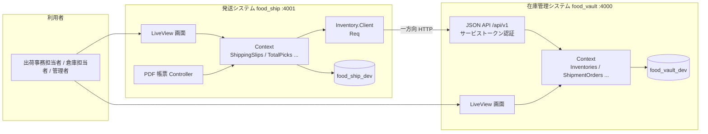
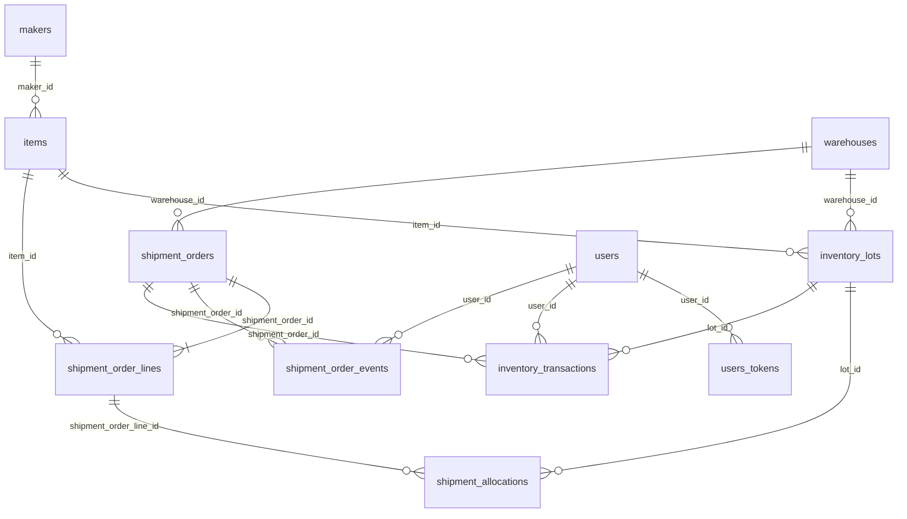
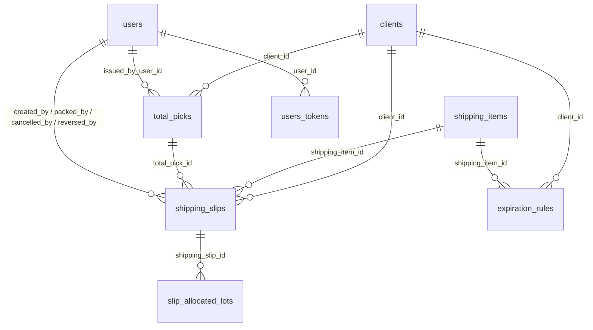
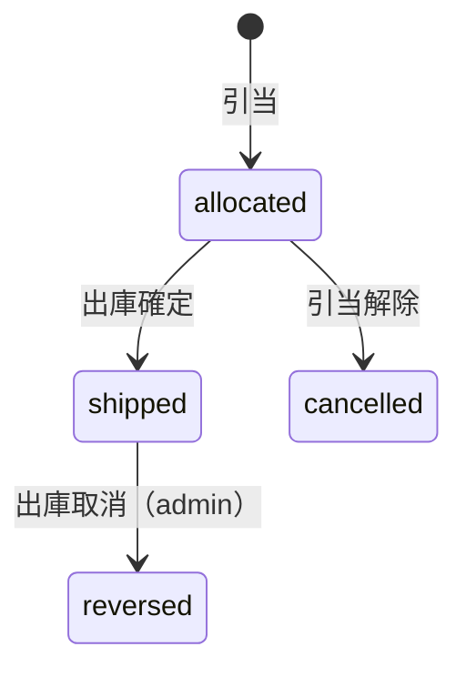
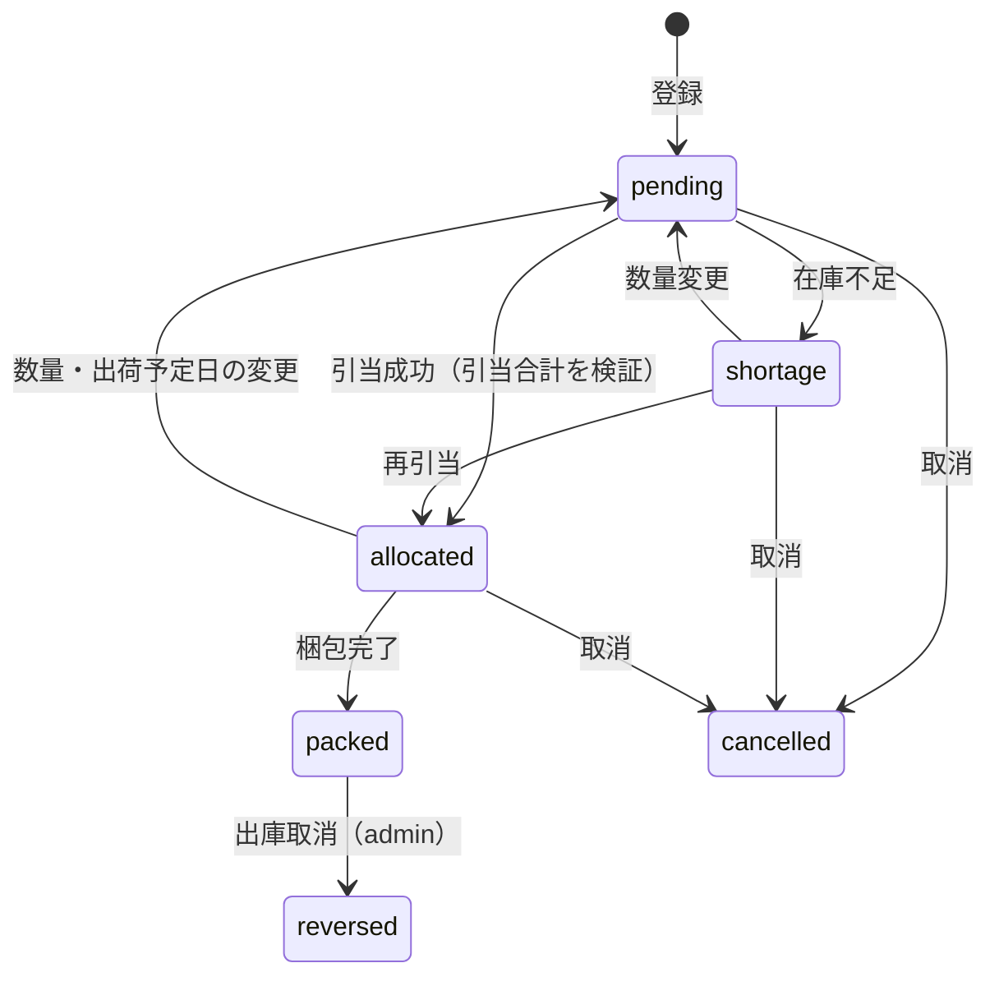
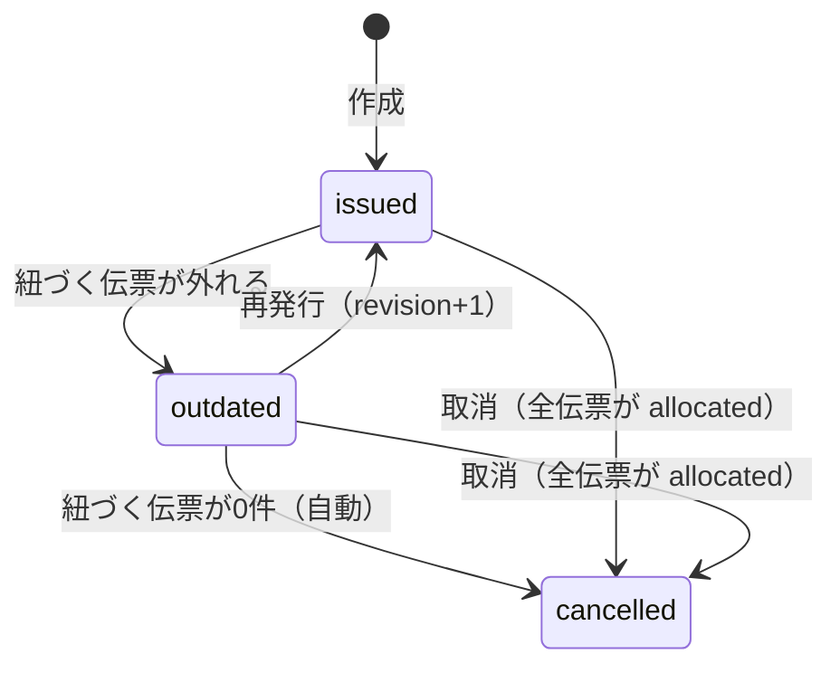
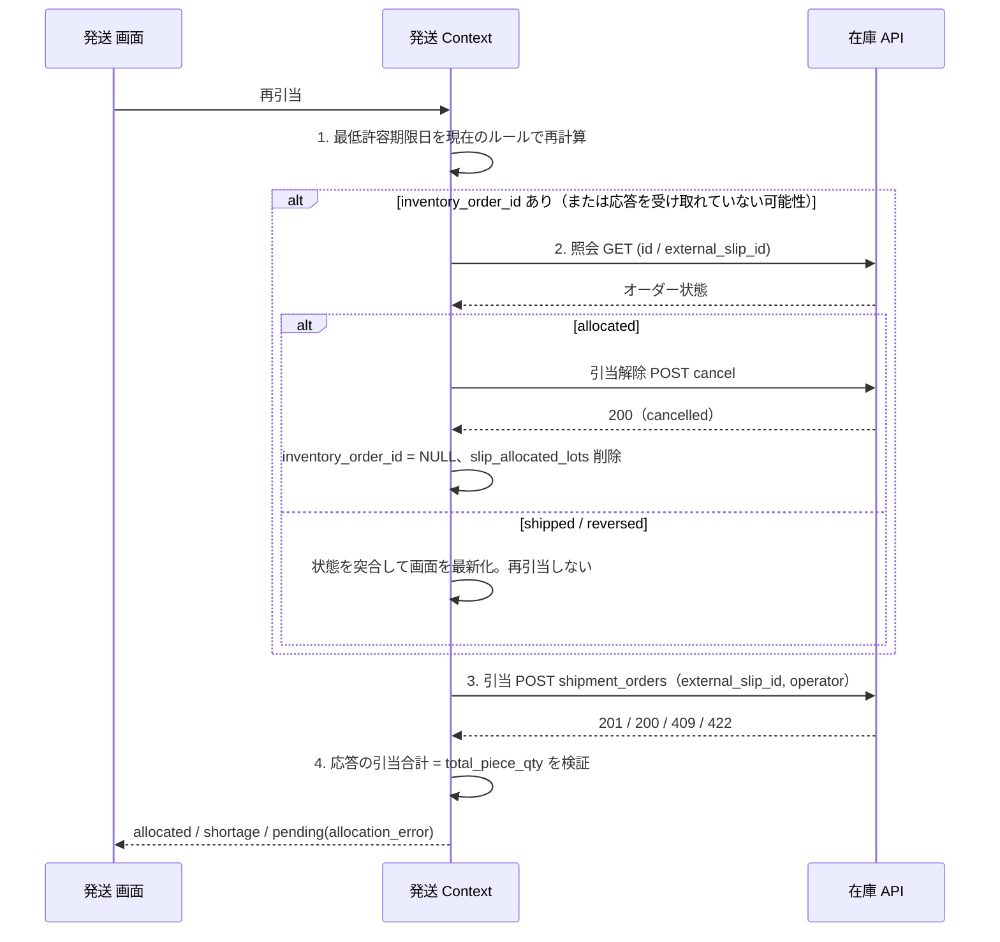

# 機能設計書 (Functional Design)

- 対象: 食品在庫管理システム（`food_vault`）と発送システム（`food_ship`）
- 位置づけ: [product-requirements.md](product-requirements.md) の要件を「どの機能が・どのデータで・どう動くか」に落とす。技術基盤・レイヤ構成・実装上の取り決めは `architecture.md` で定義する
- 用語は [glossary.md](glossary.md) に従う。出典の詳細設計は [食品在庫管理システム設計.md](ideas/食品在庫管理システム設計.md)・[発送システム 基本設計書.md](ideas/発送システム%20基本設計書.md)（いずれも v2.2）

---

## 1. システム構成

### 1.1 全体構成



- **責務の分離**: 引当・自動荷崩し・出庫確定・受払履歴などの在庫ロジックは在庫側に **1 か所だけ**持つ。発送側はこれを二重実装せず、API で呼ぶ。
- **疎結合**: DB は共有しない。連携は発送 → 在庫の一方向 HTTP のみ。発送側は在庫側の ID（商品・メーカー・ロット・オーダー）を FK ではなく ULID として保持する。
- 発送システムは **特定の 1 倉庫に固定**し、倉庫 ID を設定値（`runtime.exs`）で持つ。在庫システムは複数倉庫に対応する。

### 1.2 機能一覧

| ID | 機能 | 対象アプリ | 優先度 |
| :-- | :-- | :-- | :-- |
| F-A1 | ログインとロール | 両方 | P0 |
| F-A2 | ユーザー管理 | 両方 | P0 |
| F-V1 | マスタ管理（メーカー・倉庫・商品） | 在庫 | P0 |
| F-V2 | 入荷登録と在庫一覧 | 在庫 | P0 |
| F-V3 | 出庫引当・出庫確定・引当解除 | 在庫 | P0 |
| F-V4 | 在庫 API（①〜⑦） | 在庫 | P0（④は P1） |
| F-V5 | 棚卸調整・入荷訂正・荷まとめ | 在庫 | P0 |
| F-V6 | 受払履歴 | 在庫 | P0 |
| F-V7 | 出庫取消 | 在庫 | P1 |
| F-V8 | 緊急操作 | 在庫 | P1 |
| F-V9 | 倉庫間移動 | 在庫 | P1 |
| F-S1 | マスタ管理（発注元・発送商品・出荷期限ルール） | 発送 | P0 |
| F-S2 | 伝票登録・引当・再引当 | 発送 | P0 |
| F-S3 | 出荷日別の作業画面・数量変更・取消 | 発送 | P0 |
| F-S4 | 梱包完了 | 発送 | P0 |
| F-S5 | CSV 一括取込と一括再引当 | 発送 | P1 |
| F-S6 | トータルピックと PDF 帳票 | 発送 | P1 |
| F-S7 | 梱包完了後の取消（出庫取消） | 発送 | P1 |
| F-S8 | 一括梱包完了 | 発送 | P1 |

---

## 2. 共通規約（データ）

| 項目 | 規約 |
| :-- | :-- |
| 主キー | 全テーブル `id`、型は ULID（DB 列は `binary_id`＝`uuid`）。外部キーは `{参照先単数形}_id` |
| 列挙型 | DB の ENUM は使わず `Ecto.Enum`（DB 列は string）。値は小文字 snake_case。API の JSON でも同じ文字列 |
| 日時 | `utc_datetime` で UTC 保存し、表示直前にだけ JST へ変換。`date` 型（期限日・入荷日・出庫予定日・出荷予定日）は業務日付としてそのまま扱い、変換しない |
| 論理削除 | `is_active` は使わず `archived_at`（NULL=有効）。FK は `on_delete: :nothing`（物理削除しない） |
| 期限なし | 期限区分 `none` の商品は期限日を `9999-12-31` で保存する |
| 数量 | すべて整数。DB に CHECK 制約で不変条件を持たせる |
| 追記専用 | `inventory_transactions`・`shipment_order_events` は INSERT のみ（UPDATE / DELETE しない） |

---

## 3. データモデル

### 3.1 在庫管理システム（11 テーブル）



以降、全テーブル共通の `id`・`inserted_at`・`updated_at` は省略する（`inventory_transactions`・`shipment_order_events` は `inserted_at` のみ、`users_tokens` は `inserted_at` のみ）。

#### `makers` / `warehouses`

| カラム | 型 | 制約 |
| :-- | :-- | :-- |
| `maker_code` / `warehouse_code` | string | NOT NULL, UNIQUE |
| `maker_name` / `warehouse_name` | string | NOT NULL |
| `is_default`（`warehouses` のみ） | boolean | NOT NULL, 既定 false。デフォルト倉庫（発送システムの引当先）。部分ユニークインデックス（`WHERE is_default`）で 0 件または 1 件 |
| `archived_at` | utc_datetime | NULL可（NULL=有効） |

#### `items`

| カラム | 型 | 制約 |
| :-- | :-- | :-- |
| `maker_id` | ULID | NOT NULL, FK |
| `item_code` | string | NOT NULL, UNIQUE |
| `item_name` | string | NOT NULL |
| `units_per_case` | integer | NOT NULL, CHECK `>= 1`。ロットが存在したら変更不可 |
| `expiration_type` | Ecto.Enum | NOT NULL。`consumption` / `best_before` / `none`。ロットが存在したら変更不可 |
| `archived_at` | utc_datetime | NULL可 |

#### `inventory_lots`（倉庫 × 商品 × 期限日 × 入荷日）

| カラム | 型 | 制約 |
| :-- | :-- | :-- |
| `warehouse_id` / `item_id` | ULID | NOT NULL, FK |
| `expiration_date` | date | NOT NULL（期限なしは `9999-12-31`） |
| `received_date` | date | NOT NULL（移動でも元の入荷日を維持） |
| `case_qty` / `piece_qty` | integer | NOT NULL, DEFAULT 0 |
| `allocated_case_qty` / `allocated_piece_qty` | integer | NOT NULL, DEFAULT 0 |

- `UNIQUE (warehouse_id, item_id, expiration_date, received_date)`
- CHECK: `case_qty >= 0`、`piece_qty >= 0`、`0 <= allocated_case_qty <= case_qty`、`0 <= allocated_piece_qty <= piece_qty`
- 有効ケース数 = `case_qty - allocated_case_qty`、有効バラ数 = `piece_qty - allocated_piece_qty`、有効総バラ数 = 有効ケース数 × `units_per_case` ＋ 有効バラ数
- 在庫 0 のロットも行を削除しない。バラの自動まとめは行わない。

#### `shipment_orders` / `shipment_order_lines` / `shipment_allocations`

| テーブル | カラム | 型 | 制約 |
| :-- | :-- | :-- | :-- |
| `shipment_orders` | `warehouse_id` | ULID | NOT NULL, FK |
| | `shipment_date` | date | NOT NULL |
| | `status` | Ecto.Enum | NOT NULL, DEFAULT `allocated`。`allocated` / `shipped` / `cancelled` / `reversed` |
| | `external_slip_id` | string | NULL可。部分ユニーク `WHERE external_slip_id IS NOT NULL AND status <> 'cancelled'` |
| | `shipped_at` | utc_datetime | NULL可 |
| `shipment_order_lines` | `shipment_order_id` | ULID | NOT NULL, FK |
| | `item_id` | ULID | NOT NULL, FK |
| | `req_cases` / `req_pieces` | integer | NOT NULL, DEFAULT 0 |
| | `min_expiration_date` | date | NULL可 |
| `shipment_allocations` | `shipment_order_line_id` | ULID | NOT NULL, FK |
| | `lot_id` | ULID | NOT NULL, FK |
| | `allocated_cases` / `allocated_pieces` | integer | NOT NULL, DEFAULT 0 |

- 明細: `UNIQUE (shipment_order_id, item_id)`、CHECK `req_cases >= 0` / `req_pieces >= 0` / `req_cases + req_pieces > 0`
- 引当明細: `UNIQUE (shipment_order_line_id, lot_id)`（同じロットは 1 行に加算）、CHECK `allocated_cases >= 0` / `allocated_pieces >= 0` / 合計 `> 0`
- 部分ユニークにするのは、数量変更時に「取消 → 同じ伝票 ID で再引当」を許すため。

#### `shipment_order_events`（追記専用）

| カラム | 型 | 制約 |
| :-- | :-- | :-- |
| `shipment_order_id` | ULID | NOT NULL, FK |
| `event_type` | Ecto.Enum | NOT NULL。`created` / `shipped` / `cancelled` / `reversed` |
| `user_id` | ULID | NULL可, FK（画面操作） |
| `operator` | string | NULL可（最大 255。API 操作） |
| `reason` | string | NULL可。`reversed` と緊急操作の `shipped` / `cancelled` では必須 |

CHECK `user_id IS NOT NULL OR operator IS NOT NULL`。冪等な再送ではイベントを追加しない。

#### `inventory_transactions`（追記専用）

| カラム | 型 | 制約 |
| :-- | :-- | :-- |
| `lot_id` | ULID | NOT NULL, FK |
| `transaction_type` | Ecto.Enum | NOT NULL。`receive` / `ship` / `ship_reverse` / `auto_break` / `transfer_out` / `transfer_in` / `adjust` |
| `case_diff` / `piece_diff` | integer | NOT NULL（増減値） |
| `shipment_order_id` | ULID | NULL可, FK |
| `transfer_id` | ULID | NULL可（移動出庫と移動入庫のペアを結ぶ。参照先テーブルなし） |
| `note` | string | NULL可。調整・出庫取消では理由を必須 |
| `user_id` | ULID | NULL可, FK |
| `operator` | string | NULL可（最大 255） |

- CHECK `user_id IS NOT NULL OR operator IS NOT NULL`。
- 引当・引当解除は在庫の増減ではないため記録しない。1 回の移動で `transfer_out`（と必要なら `auto_break`）と `transfer_in` が同一トランザクションで対として記録される。
- `auto_break` は 1 ロット・1 オーダー（または 1 移動）につき 1 行（複数ケース開封でも合算）。

#### `users` / `users_tokens`

| テーブル | カラム | 型 | 制約 |
| :-- | :-- | :-- | :-- |
| `users` | `email` | citext | NOT NULL, UNIQUE |
| | `name` | string | NOT NULL |
| | `hashed_password` | string | NOT NULL, `redact: true` |
| | `role` | Ecto.Enum | NOT NULL, DEFAULT `viewer`。`admin` / `staff` / `viewer` |
| | `must_change_password` | boolean | NOT NULL, DEFAULT true |
| | `archived_at` | utc_datetime | NULL可（アーカイブ済みはログイン不可） |
| `users_tokens` | `user_id` | ULID | NOT NULL, FK |
| | `token` | binary | NOT NULL |
| | `context` | string | NOT NULL（`session`） |

`UNIQUE (context, token)`。パスワード変更・ロール変更・アーカイブ時は、そのユーザーの全セッショントークンを削除する。

#### 索引（ユニーク以外）

| テーブル | 索引 |
| :-- | :-- |
| `items` | `(maker_id)` |
| `inventory_lots` | `(item_id)` |
| `shipment_orders` | `(warehouse_id, shipment_date)` / `(status)` |
| `shipment_order_lines` | `(item_id)` |
| `shipment_allocations` | `(lot_id)` |
| `shipment_order_events` | `(shipment_order_id)` |
| `inventory_transactions` | `(lot_id)` / `(shipment_order_id)` / `(transfer_id)` / `(user_id)` / `(inserted_at)` |
| `users_tokens` | `(user_id)` |

### 3.2 発送システム（8 テーブル）



#### `clients` / `shipping_items` / `expiration_rules`

| テーブル | カラム | 型 | 制約 |
| :-- | :-- | :-- | :-- |
| `clients` | `client_code` | string | NOT NULL, UNIQUE |
| | `client_name` | string | NOT NULL |
| | `archived_at` | utc_datetime | NULL可 |
| `shipping_items` | `inventory_item_id` | ULID | NOT NULL, UNIQUE（在庫側 `items.id`。FK ではない） |
| | `item_code` | string | NOT NULL, UNIQUE（在庫側と同じ値） |
| | `inventory_maker_id` | ULID | NOT NULL（在庫側 `makers.id`。トータルピックのグルーピングに使う） |
| | `maker_name` | string | NOT NULL（登録時点のコピー） |
| | `item_name` | string | NOT NULL |
| | `boxes_per_order` | integer | NOT NULL, DEFAULT 1, CHECK `>= 1` |
| | `pieces_per_order` | integer | NOT NULL, DEFAULT 1, CHECK `>= 1` |
| | `archived_at` | utc_datetime | NULL可 |
| `expiration_rules` | `client_id` | ULID | NOT NULL, FK |
| | `shipping_item_id` | ULID | NOT NULL, FK |
| | `min_remaining_days` | integer | NOT NULL, CHECK `>= 0` |

- `shipping_items` の在庫側の値は取得時点のコピーで、自動同期しない（マスタ画面から再取得）。換算を変更しても、登録済み伝票の数量は変わらない（伝票側がスナップショットを持つ）。
- `expiration_rules`: `UNIQUE (client_id, shipping_item_id)`。**最低許容期限日 ＝ 出荷予定日 ＋ `min_remaining_days`**。未登録は制限なし。メーカー単位のルールは持たない。物理削除してよい（伝票は値を保持するため）。

#### `shipping_slips`

| カラム | 型 | 制約 / 説明 |
| :-- | :-- | :-- |
| `slip_no` | integer | NOT NULL, UNIQUE。DB シーケンスで採番（読み取り専用）。`S-000123` 形式で表示 |
| `client_id` / `shipping_item_id` | ULID | NOT NULL, FK |
| `total_pick_id` | ULID | NULL可, FK。未ピックは NULL。作成時に紐づくのは `allocated` のみ。`packed` になっても外さない。**列は `total_picks` と一緒に段階 5 で追加する**（段階 4 の `shipping_slips` には無い） |
| `client_slip_no` | string | NULL可（手入力は任意、CSV は必須） |
| `scheduled_ship_date` | date | NOT NULL（ソート・集計の基準軸） |
| `order_count` | integer | NOT NULL, CHECK `> 0` |
| `box_count` | integer | NOT NULL, CHECK `>= 1`。初期値は件数 × 標準箱数、手修正可 |
| `total_piece_qty` | integer | NOT NULL, CHECK `> 0`。件数 × 商品数量（手修正不可） |
| `min_expiration_date` | date | NULL可。引当時に適用した値 |
| `inventory_order_id` | ULID | NULL可（在庫側 `shipment_orders.id`）。引当解除に成功したら NULL に戻す |
| `status` | Ecto.Enum | NOT NULL, DEFAULT `pending`。`pending` / `allocated` / `shortage` / `packed` / `cancelled` / `reversed` |
| `shortage_pieces` | integer | NULL可。`shortage` のときだけ値を持つ |
| `allocation_error` | Ecto.Enum | NULL可。`connection`（一時）/ `unauthorized` / `not_found` / `validation_failed` / `idempotency_conflict`（恒久）。成功で NULL に戻す |
| `allocation_attempted_at` | utc_datetime_usec | NULL可。在庫 API を呼ぶ前に「確保」として更新する。同じ伝票の同時操作を見分けるためマイクロ秒精度（architecture §9.4） |
| `input_source` | Ecto.Enum | NOT NULL。`manual` / `csv` |
| `created_by_user_id` | ULID | NOT NULL, FK |
| `packed_by_user_id` / `packed_at` | ULID / utc_datetime | NULL可 |
| `cancelled_by_user_id` / `cancelled_at` | ULID / utc_datetime | NULL可 |
| `reversed_by_user_id` / `reversed_at` / `reverse_reason` | ULID / utc_datetime / string | NULL可 |

- **部分ユニーク**: `UNIQUE (client_id, client_slip_no, shipping_item_id) WHERE client_slip_no IS NOT NULL AND status NOT IN ('cancelled', 'reversed')`
- **CHECK**: `allocated` / `packed` / `reversed` なら `inventory_order_id` NOT NULL。`packed` なら `packed_at` と `packed_by_user_id`、`cancelled` なら `cancelled_at` と `cancelled_by_user_id`、`reversed` なら `reversed_at` / `reversed_by_user_id` / `reverse_reason` が NOT NULL。`shortage` 以外なら `shortage_pieces IS NULL`。
- 同じ「発注元 × 商品 × 出荷予定日」の伝票が複数あってよい（追加伝票）。
- 索引: `(scheduled_ship_date, status)` / `(total_pick_id)` / `(client_id)` / `(shipping_item_id)` / `(inventory_order_id)` / `(status, allocation_attempted_at)` と、各 `*_by_user_id` の FK 索引。

#### `slip_allocated_lots`（表示用キャッシュ。在庫の正は在庫側）

| カラム | 型 | 制約 |
| :-- | :-- | :-- |
| `shipping_slip_id` | ULID | NOT NULL, FK |
| `inventory_lot_id` | ULID | NOT NULL（在庫側 `inventory_lots.id`。FK ではない） |
| `expiration_date` | date | NOT NULL（期限なしは `9999-12-31`。画面では「期限なし」） |
| `allocated_pieces` | integer | NOT NULL, CHECK `> 0` |

`UNIQUE (shipping_slip_id, inventory_lot_id)`。再引当・数量変更では、同一トランザクションで旧行を削除して新行を保存する。発送側は常に `req_cases = 0` で要求するため、ケース引当は保存しない。

#### `total_picks`

| カラム | 型 | 制約 |
| :-- | :-- | :-- |
| `pick_no` | integer | NOT NULL, UNIQUE。DB シーケンス採番。`TP-000045` 形式 |
| `scheduled_ship_date` | date | NOT NULL |
| `client_id` | ULID | NOT NULL, FK |
| `inventory_maker_id` / `maker_name` | ULID / string | NOT NULL（作成時点の値） |
| `status` | Ecto.Enum | NOT NULL, DEFAULT `issued`。`issued` / `outdated` / `cancelled` |
| `revision` | integer | NOT NULL, DEFAULT 1, CHECK `>= 1` |
| `issued_at` | utc_datetime | NOT NULL（作成または最後の再発行） |
| `issued_by_user_id` | ULID | NOT NULL, FK |

- 明細（商品 × 期限日の合算）は持たず、紐づく伝票の引当ロット明細から都度集計する。
- 同じ「出荷予定日 × 発注元 × メーカー」に複数のピックがあってよい（追加ピック）。ユニーク制約は設けない。
- 索引: `(scheduled_ship_date, status)` / `(client_id)` / `(issued_by_user_id)`。

#### `users` / `users_tokens`

在庫側と同じ構成（`users` は在庫側と別 DB・別管理）。

---

## 4. ステータス遷移

### 4.1 出庫オーダー（在庫側）



- `shipped` / `cancelled` / `reversed` からは他のステータスへ戻れない。取消できるのは `allocated` のみ。
- 各遷移は `shipment_order_events` に同一トランザクションで記録する。

### 4.2 出荷伝票（発送側）



- `packed` / `cancelled` / `reversed` からは他へ戻らない。
- 数量変更は `allocated` / `shortage` / `pending` で可能。一度 `pending` に戻して再引当する。
- `pending` は「在庫側の引当が未完了」の総称。理由は `allocation_error` で区別する。

### 4.3 トータルピック



| 操作 | `issued` | `outdated` | `cancelled` |
| :-- | :--: | :--: | :--: |
| PDF ダウンロード | ○ | ×（先に再発行） | × |
| 再発行 | × | ○（紐づく伝票が 1 件以上） | × |
| 取消（全伝票が `allocated`） | ○ | ○ | － |

---

## 5. 在庫管理システムの機能設計

すべての更新は単一トランザクション（`Ecto.Multi` ＋ `Repo.transact/1`）で行い、途中で失敗したら全体をロールバックする。

### 5.1 共通ルール

- **ロック**: 対象ロットは `SELECT ... FOR UPDATE` で取得してから更新する。デッドロック防止のため、全操作共通のロックキー **`(warehouse_id, item_id, expiration_date, received_date, id)` の昇順**で、次の順序・単位を守る。
  1. 先に `items` 行を `item_id` 昇順で `FOR SHARE`（マスタ変更との競合対策）
  2. その操作で触るロット全体を **1 回のクエリ（`ORDER BY` ＋ `FOR UPDATE`）**でロックする。途中で追加のロットをロックしない
  3. 出庫引当は明細を `item_id` 昇順に並べ替えてから処理する
  4. 出庫確定・引当解除・出庫取消は、引当明細の `lot_id` をまとめて 1 クエリでロックする
- **出庫可能期限**: 出庫引当の対象は `expiration_date >= GREATEST(shipment_date, COALESCE(min_expiration_date, shipment_date))` のロット。
- **先出し順**: `ORDER BY expiration_date ASC, received_date ASC, id ASC`

### 5.2 入荷（F-V2）

入力: 倉庫・商品・（期限日）・入荷日・ケース数・バラ数。

1. 倉庫・商品が有効であることを検証し、`items` 行を `FOR SHARE` で読む。
2. 期限区分が `none` 以外は期限日を必須とする。`none` は `9999-12-31` を設定。
3. 「同じ倉庫 × 商品 × 期限日 × 入荷日」のロットへ `INSERT ... ON CONFLICT ... DO UPDATE` で原子的に加算（なければ新規作成）。
4. 受払履歴に `receive` を記録。

### 5.3 出庫引当（F-V3）

入力: 出庫倉庫・出庫予定日・明細（商品・`req_cases`・`req_pieces`・任意の `min_expiration_date`）・任意の `external_slip_id`・操作者（画面は `user`、API は `operator`）。

事前処理:

- **冪等チェック（API）**: `external_slip_id` があり、`cancelled` 以外の同一伝票 ID のオーダーがあれば、新規作成せず、要求内容が一致すれば既存を返し（200）、不一致は 409 `idempotency_conflict`。
- 倉庫・商品が有効か検証し、`items` 行を `item_id` 昇順で `FOR SHARE`。明細を `item_id` 昇順に並べ替える（同一オーダー内に同じ商品の明細は不可）。

明細ごとに以下を行う。

1. **対象ロットの取得**: 指定倉庫・商品のロットのうち出庫可能期限を満たすものを先出し順に取得（`FOR UPDATE`）。
2. **ステップ 1 ケース要求分（`req_cases`）**: ロットを上から走査し、有効ケース数 > 0 のロットから `req_cases` を満たすまで引き当てる。足りなければケース在庫不足として不足数を記録する。
3. **ステップ 2 バラ要求分（`req_pieces`）**: ロットを上から走査し、`req_pieces` が 0 になるまで次を繰り返す。
   1. 有効バラ数 > 0 なら、可能な限りバラから引き当てる。
   2. まだ残り、そのロットの有効ケース数 > 0 なら **同一ロット内で荷崩し**する。開封ケース数は `k = min(有効ケース数, ceil(残り要求バラ数 ÷ units_per_case))` を算術で一度に求め、`case_qty - k`・`piece_qty + k × units_per_case` を 1 回の UPDATE で行う。受払履歴に `auto_break` を 1 行（`case_diff = -k`, `piece_diff = +k × units_per_case`）記録し、増えたバラから引き当てる。
   3. それでも足りなければ次のロットへ進む。
4. 全ロットを走査しても残る分はバラ在庫不足として不足数を記録する。
5. 引当結果を `shipment_allocations` に保存（同一ロットは 1 行に加算）。

全明細の処理後:

6. **不足が 1 つでもあれば全体をロールバック**（荷崩しも元に戻る）。応答の `shortages` には不足した **全明細分**を返す。
7. 不足が無ければ、オーダー（`allocated`）・明細・引当明細・受払履歴（荷崩し）・オーダー履歴（`created`）を保存してコミット。

補足:

- ステップ 1 で引き当てたケースは引当済みのため、ステップ 2 の荷崩し対象にならない（有効ケース数で判定）。
- 荷崩しで余ったバラは、そのロットのバラ在庫として残る。
- **荷崩しは出庫取消・引当解除でも元に戻さない**。累積したバラは、棚卸調整で荷まとめする。

### 5.4 出庫確定（F-V3）

`allocated` を `shipped` にする。

1. 引当明細のロットを、ロックキー順に 1 クエリでまとめてロックする。
2. 引当明細ごとに、`case_qty` / `allocated_case_qty` を `allocated_cases` 分、`piece_qty` / `allocated_piece_qty` を `allocated_pieces` 分それぞれ減算する。
3. 受払履歴に `ship`（ロット単位）を記録する。
4. オーダーを `shipped`、`shipped_at` を現在時刻に更新し、オーダー履歴に `shipped` を記録する。

### 5.5 引当解除（F-V3）

`allocated` を `cancelled` にする。

1. 引当明細のロットをロックキー順に 1 クエリでロックし、`allocated_case_qty` / `allocated_piece_qty` を引当分だけ減算する（現在庫は変えない）。
2. オーダーを `cancelled` に更新し、オーダー履歴に `cancelled` を記録する。引当明細は **削除せず残す**。
3. 数量変更は「取消 → 新規引当」の 2 操作で行う（呼び出し側が連続実行）。

### 5.6 出庫取消（F-V7）

`shipped` を `reversed` にする（`admin` のみ）。API 経由では、在庫側は呼び出しユーザーのロールを判定できないため、**`operator` と `reason` を必須**とし、判定は呼び出し側（発送システム）の責任とする。

1. 対象の商品・倉庫がアーカイブ済みなら 409 `invalid_state`。引当明細のロットをロックキー順にロックし、`case_qty` / `piece_qty` を引当分だけ **加算**する（引当済数は変えない＝ロックは戻さない）。
2. 受払履歴に `ship_reverse` を記録（`note` に理由、API 操作は `operator` も）。
3. オーダーを `reversed` に更新し、オーダー履歴に `reversed`（理由必須）を記録する。

### 5.7 倉庫間移動（F-V9）

入力: 移動元倉庫・移動先倉庫・**対象ロット（ロット ID 指定）**・移動ケース数・移動バラ数。

事前処理: 移動元と移動先が同じ倉庫なら拒否。双方の倉庫と商品が有効であること。`items` 行を `FOR SHARE`。**移動先ロットを先に確保**（`INSERT ... ON CONFLICT DO NOTHING`、数量 0）してから、**移動元・移動先の 2 ロットをロックキー順に 1 クエリでロック**する。

1. **移動元ロットの減算**: 有効在庫の範囲で減算する。バラが不足し有効ケースがあれば、同一ロット内で自動荷崩ししてから減算する。受払履歴に `transfer_out`（荷崩しは `auto_break`）を記録。
2. **移動先ロットへの加算**: 確保した移動先ロット（同じ商品 × 同じ `expiration_date` × 同じ `received_date`）へ加算し、`transfer_in` を記録。
3. 移動出庫と移動入庫に同じ `transfer_id` を付ける（対として必ず同一トランザクションで記録）。

自動引当による移動対象ロットの自動選択は将来拡張（本バージョンは対象外）。

### 5.8 棚卸調整・廃棄・入荷訂正・荷まとめ（F-V5）

ロットを指定し、ケース数・バラ数の増減を登録する（`admin` のみ）。有効在庫（現在庫 − 引当済）を下回る減算は不可。受払履歴に `adjust`（理由を `note` に必須入力）を記録する。

| 運用 | 方法 |
| :-- | :-- |
| 入荷の誤入力の訂正 | 訂正は `admin` の棚卸調整に集約。ケース数・バラ数の誤りは増減で、期限日・入荷日の誤りは「誤ったロットの全数を減算 → 正しい期限日・入荷日で再入荷」で直す |
| 荷まとめ（バラ → ケース） | `case_diff = +k`・`piece_diff = -k × units_per_case` を 1 回の調整として登録（有効バラ数が `k × units_per_case` 以上）。理由に「荷まとめ」を記入 |
| 実在庫が引当済数を下回る場合 | `admin` が、対象ロットを引き当てているオーダー（ロット詳細に表示）の引当を緊急操作として解除してから調整する。発送システム起源のオーダーを解除した場合は、発送側で再引当が必要 |

### 5.9 マスタの変更・アーカイブ規則（F-V1）

| 対象 | 規則 |
| :-- | :-- |
| 入数・期限区分の変更 | ロット（在庫 0 を含む）が 1 件でもあれば拒否。入荷・引当・移動先作成は `items` 行を `FOR SHARE`、マスタ更新は `FOR UPDATE` で読んでから「ロットが無いこと」を検査（競合対策） |
| 商品のアーカイブ | その商品の全ロットが在庫 0 で、`allocated` のオーダー明細に含まれていないときだけ可 |
| 倉庫のアーカイブ | その倉庫の全ロットが在庫 0・引当なしのときだけ可。デフォルト倉庫は不可（別の倉庫をデフォルトにしてから） |
| デフォルト倉庫 | `admin` が倉庫一覧の「デフォルトにする」で設定・切り替える（0 件または 1 件。手動設定のみで自動設定はしない）。アーカイブ済みの倉庫は設定不可。発送システムは API ⑥ の `is_default` で引当先を取得する |
| メーカーのアーカイブ | 有効な商品を持たないときだけ可 |
| アーカイブ済みの扱い | 入荷・出庫引当・移動（元／先）の対象にできない。画面の選択肢と API ⑥⑦ の一覧に出さない。API ① で指定されたら 422 `validation_failed`。出庫取消は、対象の商品・倉庫がアーカイブ済みなら 409 `invalid_state` |
| 復帰 | `admin` が `archived_at` を NULL に戻す |

### 5.10 総バラ数の表示（F-V2）

- 入力時: 入荷・出庫・移動のすべての画面で `[ケース数]` と `[バラ数]` の 2 入力欄を設け、`units_per_case` を参照して **総数：〇〇 個** をリアルタイム表示する。
- 一覧表示時: ロット単位・商品単位の集計行に、常に `ケース数 ｜ バラ数 ｜ 総バラ数` の 3 列をセットで表示する。計算は `FoodVault.Utils.Calc` に集約する。

---

## 6. 発送システムの機能設計

### 6.1 伝票登録（手入力・CSV）（F-S2・F-S5）

1. オペレーターが「発注元」「出荷予定日」「商品」「件数」（＋任意で発注元伝票番号）を入力する、または CSV を取り込む。
2. システムがマスタを参照して「箱数」「出庫総数量（バラ）」「最低許容期限日」を自動計算する。
3. **先に伝票を `pending` で保存（コミット）してから**在庫側の引当 API を呼び、結果で `allocated` / `shortage` に更新する。在庫側の状態はロールバックできないため、API 呼び出しを DB トランザクション内に入れない。先に保存することで、通信失敗・アプリ停止があっても入力内容が消えず、`external_slip_id` による冪等な再引当で復旧できる。
4. 引当が完了（`allocated`）した伝票から、トータルピックの作成と作業指示書の出力に進む。

**CSV 取込**:

- 形式: 1 行 = 1 伝票。列は `client_code, client_slip_no, scheduled_ship_date, item_code, order_count`。**`client_slip_no` は必須**（空欄は検証エラー。二重取込を防ぐため）。文字コードは未決。
- **検証エラー（未登録の発注元・商品コード、日付・数値の不正、`client_slip_no` の重複など）が 1 行でもあればファイル全体を取り込まず**、行番号つきのエラー一覧を表示する。
- 検証を通った場合は全行を保存し（**保存は Task の前に完了**）、**出荷予定日の早い順 → ファイル順**に引当する。在庫不足は検証エラーではなく、その行は `shortage` で保存し、取込結果プレビューに引当成否を一覧表示する。
- 行数が多い場合は `Task` で引当 API の呼び出しだけを処理し、`handle_info` で進捗を更新する。
- **途中停止からの復旧**: 再起動・デプロイ・Task の異常終了で止まっても、残りは `pending` で保存済み。**一括再引当**で復旧する（進捗を持つテーブルは作らず、`pending` の件数が進捗の代わり）。

### 6.2 再引当の手順（F-S2）

「再引当」（`pending` / `shortage` の行のボタン、数量・出荷予定日の変更、一括再引当）は、在庫側に古いオーダーが残っている可能性を考慮し、次の手順で行う。



- 在庫側へ渡す `external_slip_id` は**伝票の `id`（ULID）**。再引当・数量変更でも同じ値を使い、在庫側が `cancelled` 以外の同一 ID だけを冪等判定することで「解除 → 同じ ID で再引当」ができる。
- 引当合計が `total_piece_qty` と一致しなければ `allocated` にせず、`allocation_error = validation_failed` として `pending` に残す（在庫側に残ったオーダーは、次の再引当で解除できるよう `inventory_order_id` を保存する）。
- 引当解除が失敗した場合は `pending` のまま止まり、次の再引当で手順 2 からやり直す。

**一括再引当**: `pending` / `shortage` の伝票を **出荷予定日の昇順 → `slip_no` の昇順**で順に再引当し、伝票ごとの成否を一覧表示する。恒久エラーの行は既定では対象外（修正後に個別に再引当）。

### 6.3 在庫側 API の応答の扱い

| 在庫側の応答 | 発送側の処理 |
| :-- | :-- |
| 201 / 200（成功） | 引当合計を検証 → `inventory_order_id` 保存、引当ロットを `slip_allocated_lots` に保存、`allocated`。`shortage_pieces` / `allocation_error` は NULL に戻す |
| 422 `insufficient_stock` | `shortage`、`shortage_pieces` を保存。画面にアラート |
| 422 `validation_failed` | `pending`、`allocation_error = validation_failed`（恒久）。`errors` を画面に表示 |
| 404 `not_found` | `pending`、`allocation_error = not_found`（恒久） |
| 409 `invalid_state` | 在庫側へ照会して状態を突合し、画面を最新化 |
| 409 `idempotency_conflict` | `pending`、`allocation_error = idempotency_conflict`。解除してから再引当する |
| 401 `unauthorized` | `pending`、`allocation_error = unauthorized`（恒久）。管理者向けに表示 |
| 接続エラー・タイムアウト・5xx | 自動リトライ後も失敗なら `pending`、`allocation_error = connection`（一時）。「再引当」を促す |

**画面の表示**: `pending` の行には `allocation_error` と `allocation_attempted_at` を常に表示する。一時エラーは「通信に失敗しました。再引当を押してください」、恒久エラーは「再試行しても直りません。設定またはマスタを確認してください（原因: …）」と区別する。

### 6.4 出荷日別の作業・梱包（F-S3・F-S4・F-S8）

- 作業画面は出荷予定日ごとにタブ分け・ソートして表示する。タブの「残件数」は `pending` / `allocated` / `shortage` の合計。
- 各伝票行に、引き当てられたロットの「期限日（例：2026-12-20）× 個数」を表示する。現場担当者はその期限の商品を目視確認してピッキング・梱包する。
- 梱包時に実際の箱数が変わった場合は、画面上で箱数を修正できる（在庫数には影響しない）。修正できるのは**梱包完了にする前（未梱包の間）**で、1 以上の整数。分割梱包は扱わない。

**梱包完了**:

1. 「梱包完了」ボタン（複数行の一括完了も可）を押すと確認ダイアログを表示する。
2. 在庫側の **出庫確定 API** を呼び、成功したら `packed`・`packed_at`・`packed_by_user_id` を保存し、行をグレーアウトする。
3. 一括完了は **1 伝票ずつ順に**呼び、`Task` ＋ `handle_info` で進捗（完了件数／全件）と伝票ごとの成否を表示する。失敗した伝票は `allocated` のまま残る。実行中は一括完了ボタンと対象行を無効化する。
4. 409 `invalid_state` が返った場合は在庫側へ照会し、在庫側がすでに `shipped` なら発送側も `packed` に更新する。それ以外は最新状態を表示してエラーにする。
5. **在庫側が停止している間**は梱包完了を記録できない（`allocated` のまま）。現品の出荷作業は進め、復旧後に `allocated` の伝票を選んで一括完了をやり直す（在庫側は冪等）。

### 6.5 数量変更・出荷予定日の変更（F-S3）

`allocated` / `shortage` / `pending` のみ可（商品・発注元の変更は取消して再登録）。

1. 新しい件数・出荷予定日で `box_count` / `total_piece_qty` / `min_expiration_date` を再計算し、`pending` として保存。
2. 再引当の手順（§6.2）で、旧オーダーを照会・引当解除（`slip_allocated_lots` を削除、`inventory_order_id` を NULL）し、引当 API を新しい内容で呼ぶ。
3. 引当合計を検証し、結果で `allocated` / `shortage` にする。解除が失敗した場合は `pending` のまま止まり、「再引当」で手順 2 からやり直す。

トータルピックに紐づく伝票は、手順 1 でピックから外れる（確認ダイアログに「トータルピック TP-xxxxxx から外れ、再発行が必要になります」と表示）。解除と再引当はアトミックではなく、再引当が在庫不足になると旧引当は解除されたまま `shortage` になる。確認ダイアログに「在庫不足の場合、現在の引当は解除されます」と明記する。

### 6.6 伝票の取消と梱包完了後の取消（F-S3・F-S7）

- **梱包前の取消**: `allocated` は引当解除 API を呼んで `cancelled`。`shortage` / `pending` は（オーダーがあれば、または照会で未解除のオーダーが見つかれば解除してから）`cancelled`。`cancelled_at` / `cancelled_by_user_id` を保存。トータルピックに紐づく伝票はピックから外れ、ピックは要再発行になる。
- **梱包完了後の取消（出庫取消）**（`admin` のみ）:
  1. 理由を必須とし、在庫側の出庫取消 API を `operator`（実行した管理者のメール）と `reason` を付けて呼ぶ。管理者判定は発送側が行う。
  2. 成功したら `reversed` にし、`reversed_at` / `reversed_by_user_id` / `reverse_reason` を保存する。在庫は元のロットに戻る（**引当ロックは再設定されない**ため、出荷が必要なら「複製して再登録」で新しい伝票を作る）。
  3. 在庫側にも `ship_reverse` / `reversed`・理由・`operator` が残る。

### 6.7 追加伝票への対応

梱包完了後に追加の伝票が届いても、同じ出荷予定日タブ内に「未梱包」としてハイライト表示する。梱包済みの在庫は在庫側で減算済み、未梱包の引当済み在庫はロック済みのため、残りの有効在庫から先出しで引当される。

### 6.8 トータルピックの作成と帳票（F-S6）

**トータルピックとは**: 同じ「出荷予定日 × 発注元 × メーカー」の引当済み伝票を、商品 × 期限日ごとに合算してまとめてピッキングし、伝票ごとに仕分ける作業単位。

作成手順（作業画面の出荷予定日タブから `staff` 以上が実行）:

1. 「トータルピック作成」を押すと、**未ピックの引当済み伝票**（`status = allocated` かつ `total_pick_id` が NULL）が「発注元 × メーカー」のグループに分かれて一覧表示される（伝票数・商品数・合計バラ数のプレビュー付き）。
2. 対象グループを選んで作成する。グループごとに 1 つの `total_picks` が作成され、対象伝票の `total_pick_id` が設定される。ピック挿入と伝票更新は 1 つの Multi で行い、`FOR UPDATE` で対象伝票をロックする（同時作成では後続は対象 0 件で失敗し、二重ピックにならない）。
3. 作成後は詳細画面へ遷移し、PDF をダウンロードできる。

対象外: `pending` / `shortage`、`packed` / `cancelled` / `reversed` の伝票、すでにトータルピックに紐づいた伝票。

**追加伝票・変更への対応**:

- ピック作成後に届いた追加伝票は、同じグループの別のトータルピック（追加ピック）として作成する。既存のピックは変更しない。
- 紐づき済みの伝票を数量変更・出荷予定日変更・取消・出庫取消したときは、その伝票をピックから外し（`total_pick_id` を NULL）、ピックを要再発行（`outdated`）にする。数量変更・出荷予定日変更で外れた伝票は未ピックに戻り、再引当後に再度ピック作成の対象になる。
- ピック表の集計対象は、紐づく伝票すべて（**梱包済みを含む**）。梱包完了（`packed`）はピックの状態に影響しない。
- 要再発行のピックは「再発行」で `revision` を加算し、**そのあとで初めて PDF を出力できる**（`outdated` のままでは出力不可）。紐づく伝票が 0 件になったピックは自動で `cancelled`。
- ピックの取消は、紐づく伝票がすべて未梱包（`allocated`）のときだけ可能（伝票は未ピックに戻る）。

### 6.9 帳票（PDF）

| 帳票 | 単位 | 内容 |
| :-- | :-- | :-- |
| トータルピック表 | トータルピック 1 件につき 1 通 | ヘッダ: ピック番号・版・出荷予定日・発注元・メーカー・発行日時・発行者。明細: 商品コード・商品名・**期限日**・合計バラ数・合計件数・合計箱数・チェック欄。最終行に合計。後半に **仕分け表**（明細行ごとの「伝票番号 × 数量」の内訳） |
| 作業指示書 | 伝票 1 件につき 1 枚 | 伝票番号・発注元・発注元伝票番号・出荷予定日・メーカー・商品コード・商品名・件数・箱数・出庫数量（バラ）・**引当ロットの期限日 × 個数**・最低許容期限日（ルールがある場合）・所属トータルピック番号。実績記入欄（実際の箱数・担当者・検品） |

- 明細の合算キーは「商品 × **期限日**」（在庫側のロットが入荷日違いで分かれていても、現場で見分けられないため期限日で集約）。集計は都度、伝票の引当ロット明細から算出する（合計値を別テーブルに持たない）。
- 作業指示書は、`allocated` または `packed` の任意の伝票から単体で出力できる（ピックの状態にかかわらず）。
- ピック作成時は、トータルピック表と所属伝票の作業指示書を 1 つの PDF（ピック表 → 作業指示書を `slip_no` 昇順）でダウンロードできる。個別ダウンロードも可。
- 帳票は **都度生成して保存しない**。日時は JST で表示する。A4 縦・日本語フォント（Noto Sans JP）。バーコード／QR は印字しない（`slip_no` / `pick_no` の数字表示のみ）。

### 6.10 マスタ（F-S1）

- **発送商品**: 登録は「商品コードで取得 → 標準箱数・商品数量を入力して保存」の 2 段階（取得した在庫側の値は画面に載せずサーバー側で保持する）。編集できるのは換算（標準箱数・商品数量）だけで、在庫側の値は「再取得」で更新する。商品コードを入力すると、在庫側 `GET /api/v1/items?item_code=` から `inventory_item_id`・`item_name`・`inventory_maker_id`・`maker_name` を取得して初期入力する。取得した値のコピーであり、在庫側の変更は自動同期しない（マスタ画面から再取得）。再取得で `inventory_maker_id` が変わっても、作成済みトータルピックには影響しない。
- **出荷期限ルール**: 引当時点の最低許容期限日は伝票が保持するため、ルールを後から変更・削除しても **引当済み・梱包済みの伝票**には影響しない。`shortage` / `pending` の再引当は、その時点のルールで再計算する。
- **発注元**: アーカイブ済みは新規伝票の選択肢に出さない。

### 6.11 例外ケースへの対策

| 例外シナリオ | 挙動・対策 |
| :-- | :-- |
| ① 伝票入力時に在庫不足 | 入力内容は消さず `shortage` で保存し、不足数を表示。入荷後に再引当（個別・一括）。再引当は最低許容期限日を再計算し、成功したら `shortage_pieces` を NULL に戻す |
| ② 引当 API の通信失敗 | `pending`（`connection`）で保存済み。再引当で復旧（冪等・内容一致） |
| ③ 梱包前の件数変更 | §6.5 |
| ④ 梱包前の伝票取消 | §6.6 |
| ⑤ 同じ伝票の二重登録 | `client_slip_no` の部分ユニーク制約で防止（画面では「すでに登録されています」） |
| ⑥ 梱包完了後の取消 | §6.6 |
| ⑦ 在庫側マスタとの不整合 | 在庫側の商品が見つからない（404）／アーカイブ済み（422）は画面に原因を表示（恒久エラー）。マスタ画面の「再取得」で在庫側の値を取り込む |
| ⑧ 在庫側 API の停止 | 引当は `pending`（`connection`）、梱包完了は `allocated` のまま失敗。復旧後に一括再引当・一括梱包完了をやり直す |
| ⑨ 出荷が近い伝票が `shortage`、遠い日付の伝票が引当を保持している | 引当は先着順で、自動の振り替えはしない。担当者が、遠い日付の伝票を数量変更（解除）または取消して在庫を空け、近い日付の伝票を再引当し、その後に遠い日付の伝票を再引当する |

---

## 7. システム間連携（在庫 API）

### 7.1 API 一覧

提供側は在庫システム。Controller（`FoodVaultWeb.Api.V1.*`）と `:api` pipeline で実装する（LiveView 対象外）。ベースパスは `/api/v1`。ID は ULID 文字列、日付は ISO 8601（`YYYY-MM-DD`）、列挙値は小文字 snake_case 文字列。

| # | メソッド / パス | 用途 | 成功時 |
| :-- | :-- | :-- | :-- |
| ① | `POST /api/v1/shipment_orders` | 出庫引当 | 201（冪等再送は 200） |
| ② | `POST /api/v1/shipment_orders/:id/ship` | 出庫確定 | 200 |
| ③ | `POST /api/v1/shipment_orders/:id/cancel` | 引当解除 | 200 |
| ④ | `POST /api/v1/shipment_orders/:id/reverse` | 出庫取消（`operator`・`reason` 必須） | 200 |
| ⑤ | `GET /api/v1/shipment_orders/:id` / `?external_slip_id=` | 状態・引当結果の照会（突合・通信断の復旧用） | 200 |
| ⑥ | `GET /api/v1/warehouses` | 有効な倉庫の一覧 | 200 |
| ⑦ | `GET /api/v1/items?item_code=` | 商品コードで有効な商品を検索。`item_code` 省略時は一覧。応答に `maker_id`・`maker_name` を含む | 200 |

- **認証**: `Authorization: Bearer <token>`。トークンは環境変数 `INVENTORY_API_TOKENS`（カンマ区切り・複数可＝ローテーション用）で、未設定なら起動時に落とす。比較は定数時間。ローテーションは「新トークンを追加 → 発送側を切り替え → 旧トークンを削除」。API は画面と同じ Endpoint のため、本番は TLS を終端し `/api` を発送システムの送信元（社内ネットワーク）に限定する。
- **操作者**: 状態を変える API（①〜④）は **`operator`（最大 255 文字）を必須**とし、受払履歴・オーダー履歴に残す。
- **エラー形式**: 全エンドポイント共通で `{ "error": "<code>", "message": "<説明>", ...付加情報 }`。

### 7.2 リクエスト・レスポンス

**① 出庫引当**:

```json
{
  "warehouse_id": "01JA...",
  "shipment_date": "2026-11-15",
  "external_slip_id": "01JB...",
  "operator": "staff@example.com",
  "lines": [
    { "item_id": "01JC...", "req_cases": 0, "req_pieces": 3, "min_expiration_date": "2026-12-15" }
  ]
}
```

**共通のオーダー表現**（①②③④⑤ の成功時レスポンス）:

```json
{
  "order_id": "01JD...",
  "external_slip_id": "01JB...",
  "warehouse_id": "01JA...",
  "shipment_date": "2026-11-15",
  "status": "allocated",
  "shipped_at": null,
  "lines": [
    {
      "item_id": "01JC...",
      "req_cases": 0,
      "req_pieces": 3,
      "min_expiration_date": "2026-12-15",
      "allocations": [
        { "lot_id": "01JE...", "expiration_date": "2026-12-20", "allocated_cases": 0, "allocated_pieces": 3 }
      ]
    }
  ]
}
```

**②〜⑤**:

| # | リクエスト | レスポンス |
| :-- | :-- | :-- |
| ② | `{ "operator": "..." }` | オーダー表現（`status: "shipped"`、`shipped_at`） |
| ③ | `{ "operator": "...", "reason": "..." }`（`reason` は任意） | オーダー表現（`status: "cancelled"`。引当明細は残して返す） |
| ④ | `{ "operator": "...", "reason": "..." }`（どちらも必須） | オーダー表現（`status: "reversed"`） |
| ⑤ `:id` | なし | オーダー表現。存在しなければ 404 |
| ⑤ `?external_slip_id=` | なし | `{ "shipment_orders": [オーダー表現, ...] }`（取消済みを含め新しい順。該当なしは空配列で 200） |

**⑥⑦**:

```json
{ "warehouses": [{ "id": "01JA...", "warehouse_code": "W01", "warehouse_name": "第1倉庫", "is_default": true }] }
{ "items": [{ "id": "01JC...", "item_code": "4901234567894", "item_name": "商品A", "maker_id": "01JF...", "maker_name": "メーカーX", "units_per_case": 12, "expiration_type": "best_before" }] }
```

### 7.3 冪等性

- **①**: 同じ `external_slip_id`（`cancelled` 以外）の再送は、要求内容（`warehouse_id`・`shipment_date`・各明細の `item_id`・`req_cases`・`req_pieces`・`min_expiration_date`。明細は `item_id` 順に正規化）が既存オーダーと一致する場合に限り、再処理せず既存を返す（200）。**不一致は 409 `idempotency_conflict`**。同時 POST でユニーク制約違反になった側は、既存オーダーを再取得して同じ比較を行う（500 にしない）。
- **②③④**: すでにその状態なら 200 で現状を返す（②`shipped`、③`cancelled`、④`reversed`）。それ以外の状態からは 409 `invalid_state`。冪等応答ではオーダー履歴・受払履歴を追加しない。

### 7.4 エラー応答

```json
{ "error": "insufficient_stock", "message": "在庫が不足しています。", "shortages": [{ "item_id": "01JC...", "shortage_cases": 0, "shortage_pieces": 2 }] }
```

| HTTP | `error` | 発生条件 | 発送システム側の扱い |
| :-- | :-- | :-- | :-- |
| 401 | `unauthorized` | トークン不正 | 設定エラー（リトライ不可） |
| 404 | `not_found` | オーダー・倉庫・商品が存在しない（パスの ID 形式不正を含む） | 不整合として通知 |
| 409 | `invalid_state` | 状態遷移として不正。出庫取消で対象の商品・倉庫がアーカイブ済みの場合も | 在庫側へ照会して最新化 |
| 409 | `idempotency_conflict` | 同じ `external_slip_id` の既存オーダーと内容が異なる。応答に既存の `order_id` と `status` を含む | 既存を照会し、解除してから再引当 |
| 422 | `insufficient_stock` | 期限条件を満たす在庫が不足（ロールバック済み）。`shortages` は不足した全明細分 | `shortage` で保存 |
| 422 | `validation_failed` | 入力不正（数量が負、明細が空、`operator` 欠落、ボディの ID 形式不正、アーカイブ済みの商品・倉庫など）。`errors` に項目別メッセージ（`[{ "path": ["lines", 0, "req_cases"], "message": "..." }]`。`path` は入力のキーと明細の位置） | 入力エラーとして表示 |

### 7.5 呼び出し方針（発送側 `FoodShip.Inventory.Client`）

- すべて冪等な呼び出し。リトライは `retry: :transient` を明示（Req の既定は GET / HEAD 以外を再試行しない）。最大 3 回、待機 1 秒・2 秒・4 秒。対象は接続エラー・タイムアウトと 408 / 429 / 500 / 502 / 503 / 504。401 / 404 / 409 / 422 は再試行しない。
- タイムアウト: 接続 5 秒・受信 15 秒（設定値）。
- 画面からの呼び出しは `Task` ＋ `handle_info` で非同期に行い、実行中は対象の行・ボタンを無効化する。

### 7.6 在庫側への依存

| 発送側の機能 | 在庫側の仕様 |
| :-- | :-- |
| 突合・通信断の復旧 | ⑤ 照会 API（`:id` と `?external_slip_id=`）、共通のオーダー表現 |
| 再引当と 409 `idempotency_conflict` | 冪等性の内容一致判定 |
| 出庫取消の `operator` / `reason` | ④ 出庫取消 |
| トータルピックのメーカー別グルーピング | ⑦ 応答の `maker_id` |
| 404 / 422 の扱い | アーカイブ済み商品・倉庫は 422 `validation_failed` |

---

## 8. 画面設計

### 8.1 在庫管理システム

| 画面 | 主な内容 | 必要ロール |
| :-- | :-- | :-- |
| ログイン / ログアウト | メール＋パスワード。未ログインは全画面からログイン画面へ。ログイン後は元のページへ戻る | 未ログイン可 |
| パスワード変更（自分） | 現在のパスワード＋新パスワード。`must_change_password` の強制遷移先 | 全ロール |
| 在庫一覧 | 倉庫・商品・期限の絞り込み。ロット別／商品別の集計。ケース／バラ／総バラ、引当済、有効在庫を表示。期限の近い順。ロット詳細に、そのロットを引き当てているオーダーを表示 | 全ロール（参照） |
| 入荷登録 | 倉庫・商品・期限日・入荷日・ケース数・バラ数（総数をリアルタイム表示） | `staff` 以上 |
| 出庫オーダー一覧・詳細・登録 | 登録時に自動引当（画面登録のオーダーは `external_slip_id` なし）。詳細に引当ロット（期限日 × 数量）とオーダー履歴を表示。取消・出庫確定の操作。発送システム起源のオーダーには「発送システムと状態がずれます」の警告を表示し、確定・引当解除は緊急操作（理由必須）としてのみ許可 | 参照は全ロール／画面登録オーダーの登録・確定・取消は `staff` 以上／発送システム起源オーダーの確定・引当解除（緊急操作）と出庫取消は `admin` |
| 倉庫間移動 | 移動元ロットを選択して移動先倉庫・数量を指定 | `staff` 以上 |
| 棚卸調整（入荷訂正・荷まとめを含む） | ロット指定の増減登録（理由必須） | `admin` |
| 受払履歴 | ロット・商品・期間・処理区分・操作ユーザーで検索。移動ペア・出庫オーダーへのリンク | 全ロール（参照） |
| マスタ管理 | メーカー・倉庫・商品の CRUD（アーカイブ操作含む） | 参照は全ロール／編集は `admin` |
| ユーザー管理 | 一覧・登録・ロール変更・パスワード再設定・アーカイブ | `admin` |

ルーティング: 参照・業務画面は `/inventory_lots` 等の一般パス、`admin` 専用画面（棚卸調整・マスタ編集・ユーザー管理）は `/management/...`、認証系は `/users/log_in` 等。

### 8.2 発送システム

| 画面 | 主な内容 | 必要ロール |
| :-- | :-- | :-- |
| ログイン / ログアウト / パスワード変更 | 在庫側と同じ | 全ロール |
| 伝票登録・CSV 取込 | 手入力フォーム（発注元・出荷予定日・商品・件数・発注元伝票番号。箱数・バラ数・最低許容期限日をリアルタイム計算）。CSV ドラッグ＆ドロップ取込（検証エラー一覧／引当成否のプレビュー） | `staff` 以上 |
| 出荷日別 作業・梱包消込（メイン） | 出荷予定日別のサマリータブ（例：11/14 (残0件)、11/15 (残3件)）。状態フィルタ（未梱包のみ／在庫不足のみ／未ピックのみ／すべて）。伝票一覧（伝票番号、ピック番号、ピッキング対象の期限日、箱数のインライン編集、個別・一括の梱包完了、個別・一括の再引当、数量変更、取消、作業指示書 PDF。`pending` の行には引当エラーの種別と最終試行日時を表示）。タブ内に「トータルピック作成」ボタン（発注元 × メーカーのグループ選択ダイアログ） | 参照は全ロール／操作・PDF 出力は `staff` 以上／梱包完了後の取消は `admin` |
| トータルピック一覧・詳細 | 出荷予定日・発注元・メーカー・状態（発行済／要再発行／取消）で検索。詳細にピック明細（商品 × 期限日の合算）・仕分け内訳・紐づく伝票一覧。PDF ダウンロード（ピック表のみ／ピック表＋作業指示書。`outdated` は再発行後のみ）、再発行、取消 | 参照は全ロール／PDF・再発行・取消は `staff` 以上 |
| マスタ管理 | 発注元、発送商品・梱包換算（在庫側から再取得）、出荷期限ルールの CRUD | 参照は全ロール／編集は `admin` |
| ユーザー管理 | 一覧・登録・ロール変更・パスワード再設定・アーカイブ | `admin` |

**段階 4 で実装したルーティング（発送）**: `/`（作業画面へ redirect）、`/shipping_slips`（作業画面。`?date=YYYY-MM-DD&filter=all|unpacked|shortage`。全ロール）、`/shipping_slips/new`・`/shipping_slips/:id/edit`（伝票登録・数量変更。`staff` 以上）、`/masters/clients`・`/masters/shipping_items`・`/masters/expiration_rules`（参照。全ロール）、`/management/{clients,shipping_items,expiration_rules}/new|:id/edit`（編集。`admin`）。対象倉庫（在庫のデフォルト倉庫。引当のたびに API ⑥ で取得する）が未設定の間は、伝票登録・再引当・数量変更を拒否して画面に警告を出す（在庫 API に接続できないときは警告を出さず、操作時に通信エラーを表示する）。

PDF 帳票は LiveView ではなく Controller（`ReportController`：`total_pick/2`・`work_order/2`・`total_pick_bundle/2`）でダウンロード配信し、認可は HTTP plug で `staff` 以上に限定する。

---

## 9. 認証・認可

### 9.1 方式

- 在庫・発送とも、`mix phx.gen.auth` をベースに、**自己登録・マジックリンク・メール確認を取り除き、パスワード認証のみ**にする。ユーザーは管理者が登録し、在庫と発送で別管理（別 DB）。
- 現在ユーザーは Phoenix 1.8 の `current_scope`（`current_scope.user`）で扱い、`<Layouts.app current_scope={@current_scope} ...>` に渡す。
- パスワードは bcrypt でハッシュ化、最小 12 文字。ログイン失敗時のエラーは「メールアドレスまたはパスワードが正しくありません。」の 1 種類のみ（存在しないメール・パスワード誤り・アーカイブ済みを区別しない）。
- 「ログインしたままにする」（remember me）は `phx.gen.auth` の既定を踏襲する（cookie 14 日）。セッションの有効期間は 14 日。ログイン試行制限は対象外（P2）。
- 画面は `/users/log_in`（ログイン）、`/users/password`（自分のパスワード変更。現在のパスワードが必要）、`/management/users`（ユーザー管理。`admin` のみ）。`/` を含む保護画面は未ログインでログイン画面へ遷移し、ログイン後は元のページへ戻る。`must_change_password = true` のユーザーは、パスワードを変更するまで `/users/password` 以外へ進めない。
- パスワード再設定は **管理者が行う運用**（メール送信基盤を使わない）。再設定後は `must_change_password = true`。
- 初期管理者は seeds（開発）／リリースタスク（本番）で作成する。初期パスワードは環境変数から読み、作成後に `must_change_password = true`。

### 9.2 ユーザー管理ルール

- ユーザーの作成・ロール変更・パスワード再設定・アーカイブは `admin` のみ。
- **有効な `admin` を常に 1 人以上残す**。最後の `admin` の降格・アーカイブ、自分自身のロール変更・アーカイブは Context で拒否する。
- アーカイブ済みユーザーのメールアドレスは再利用不可。復帰は `archived_at` を NULL に戻す。
- パスワード変更・ロール変更・アーカイブ時は、そのユーザーの全セッショントークンを削除する。

### 9.3 権限表

**在庫管理システム**

| 操作 | `admin` | `staff` | `viewer` |
| :-- | :--: | :--: | :--: |
| 在庫一覧・受払履歴・出庫オーダー・マスタの参照 | ○ | ○ | ○ |
| 自分のパスワード変更 | ○ | ○ | ○ |
| 入荷登録 | ○ | ○ | － |
| 画面登録オーダーの登録（自動引当）・出庫確定・引当解除 | ○ | ○ | － |
| 発送システム起源オーダーの確定・引当解除（緊急操作。理由必須・警告表示） | ○ | － | － |
| 倉庫間移動 | ○ | ○ | － |
| 棚卸調整・廃棄・入荷訂正・荷まとめ | ○ | － | － |
| 出庫取消（`shipped` → `reversed`） | ○ | － | － |
| マスタ（メーカー・倉庫・商品）の編集・アーカイブ | ○ | － | － |
| ユーザー管理 | ○ | － | － |

**発送システム**

| 操作 | `admin` | `staff` | `viewer` |
| :-- | :--: | :--: | :--: |
| 伝票・作業画面・マスタの参照 | ○ | ○ | ○ |
| 自分のパスワード変更 | ○ | ○ | ○ |
| 伝票登録（手入力・CSV）・再引当（個別・一括）・数量変更・取消 | ○ | ○ | － |
| 箱数の修正・梱包完了（個別・一括） | ○ | ○ | － |
| トータルピックの作成・再発行・取消、帳票（PDF）のダウンロード | ○ | ○ | － |
| 梱包完了後の取消（出庫取消） | ○ | － | － |
| マスタ（発注元・発送商品・出荷期限ルール）の編集 | ○ | － | － |
| ユーザー管理 | ○ | － | － |

- 上位ロールは下位ロールの操作を含む（`admin` ⊃ `staff` ⊃ `viewer`）。判定は `Permission.can?(user, action)` に一本化し、ボタン表示とイベント処理の両方で同じ関数を呼ぶ。
- 在庫側の出庫取消は `admin` 限定だが、API 経由では在庫側は呼び出しユーザーのロールを判定できない。**管理者判定は発送システムの責任**とし、サービストークンの管理と `operator` の記録で担保する。

### 9.4 認可の層

| 層 | 実装 |
| :-- | :-- |
| ① HTTP plug | `require_authenticated_user`（全ロール）／`require_authenticated_admin_user`（`admin`） |
| ② LiveView `on_mount` | `:ensure_authenticated`（全ロール）／`:ensure_authenticated_staff`（`staff` 以上）／`:ensure_authenticated_admin`（`admin`）。plug と同じ強さのフックを `live_session` に必ず指定する（LiveView 間遷移は plug を通らないため） |
| ③ イベント単位 | 同一画面に複数ロールが入る画面は、`handle_event` の先頭で `Permission.can?/2` を検査し、不許可なら `put_flash(:error, "権限がありません。")`。テンプレートの `:if` だけで隠さない |

---

## 10. 監査・ログ

- 業務上の証跡は DB が担う: 在庫の増減は `inventory_transactions`、出庫オーダーの状態遷移は `shipment_order_events`、発送側の伝票は `created_by_user_id` / `packed_by_*` / `cancelled_*` / `reversed_*`。
- ログイン成功・失敗は Logger カテゴリ `:log_in` で記録し、書き込み操作は操作ログに操作ユーザーを含める（Logger は補助）。パスワード等は `redact: true` により自動マスクされる。
